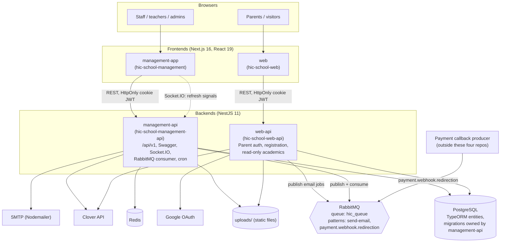
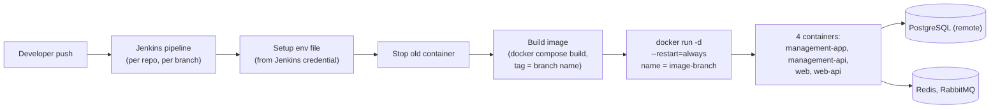

# Architecture

This document breaks the product down repo by repo. It is derived from the source trees, `package.json` files, configuration, and CI/CD files. No secrets or environment values are reproduced here.

## System diagram



## Cross-cutting design

| Concern | Approach |
|---|---|
| **Authentication** | Custom JWT (HS256) via Passport. Token read from an HttpOnly cookie or a bearer header. Every request re-loads the user, rejects inactive / disabled / locked accounts, and checks a Redis force-logout flag. |
| **Authorization** | `@Permissions([...])` decorator + global `PermissionGuard`. Permissions are strings (slugs) in the `permissions` table, granted through roles and directly to users; the effective set is cached in Redis. |
| **Validation** | Global `ValidationPipe` (whitelist, forbid unknown properties, implicit conversion) with class-validator DTOs. |
| **Error handling** | Global exception filter; unified success response DTO and transform interceptor. |
| **Audit** | TypeORM subscriber writes `audit_logs` rows (old/new JSONB, IP, actor, impersonator). |
| **Async work** | RabbitMQ (email jobs, payment-webhook events) with retry headers, timeouts, and safe-ack handling. |
| **Realtime** | Socket.IO gateway emits signal-only events (`admin-notice:updated`, `user-roles:updated`); clients refetch over REST. |
| **Money / ledger** | Orders (`student_fees`) with items, schedules, and payments; double-entry journal entries and general ledger. |

---

## 1. `hic-school-management` (management-app)

**Purpose.** Internal dashboard for administrators, accountants, teachers, and staff.

**Stack.** Next.js 16 (App Router, Turbopack dev), React 19, TypeScript, Tailwind CSS 4, Radix UI-based component library, React Hook Form + Zod, Zustand, Axios, Recharts, TipTap, `@react-pdf/renderer`, dnd-kit, socket.io-client.

**Trimmed structure**

```
src/
├── app/
│   ├── (auth)/              login, reset-password
│   ├── (admin)/dashboard/
│   │   ├── academics/       admission, programs, program-config, program-settings,
│   │   │                    products, classes, levels, my-level, my-classes,
│   │   │                    grading, session, registration
│   │   ├── students/        student-list, registrations, scholarships, attendance,
│   │   │                    attendance-stats, results, parent-contacts, my-student
│   │   ├── faculty/         members, proxy-access, home-work
│   │   ├── schedule-management/  timetable, events, exams
│   │   ├── finance/         fees-collection, expenses, payroll, disburse,
│   │   │                    teachers, reports
│   │   ├── user-management/ users, administration, roles, permission
│   │   ├── communication/   admin-notice, send-mail
│   │   ├── settings/        admin-settings, payroll-types, expense-categories, activities
│   │   ├── profile/         profile, change-password, my-attendance, my-proxy-classes
│   │   └── demo/            email and report template previews
│   └── payment/             payment result page
├── components/              common UI kit, layout (sidebar, impersonation banner),
│                            providers (global context), tiptap editor
├── modals/                  ~50 add/edit/view modals (payments, scholarships, roles, ...)
├── services/                one Axios-based service per API area (~50 files)
├── store/                   Zustand stores (fees, registration, notifications)
├── hooks/                   permission guard, URL state, keyboard shortcuts, etc.
├── lib/                     http client, socket, pdf (invoice), date and filter helpers
├── models/ + types/         TypeScript models mirroring API entities
├── constants/               navigation, permissions, key names
└── proxy.ts                 Next.js proxy: redirects unauthenticated users to /login
```

**Notable implementation points**

- Navigation is defined once in `constants/navigations.ts` and filtered by the user's permissions.
- `GlobalProviders` holds the user, roles, admin settings, and active notices, and subscribes to Socket.IO events to refresh them live.
- An `ImpersonationBanner` shows on every dashboard page during impersonation, with a countdown and exit.
- Complex pages (admission order detail) are composed of focused components: order info, items, payments, installments, refund, scholarship, change-program, activity log.

**Deployment.** `cicd/docker/Dockerfile`, `docker-compose.yml`, `cicd/jenkins/Jenkinsfile`, and shell scripts in `cicd/scripts/` (environment setup, image build, container stop, image remove). Environment values come from a Jenkins-managed env file credential (not stored in the repo).

**Repo hygiene note.** The README in this repo is partly outdated (mentions Next.js 15, mock JSON data); the code uses Next.js 16 and live API services.

---

## 2. `hic-school-management-api` (management-api)

**Purpose.** Backend for the dashboard: all admin, academic, finance, payroll, and security logic. Owns migrations and consumes the message queue.

**Stack.** NestJS 11, TypeORM 0.3, PostgreSQL (`pg`), Redis (`ioredis`), RabbitMQ (`@nestjs/microservices`, `amqplib`), Socket.IO, Passport (JWT, local), Nodemailer, Puppeteer, PDFKit, ExcelJS, json2csv, Winston, Swagger, Helmet, Throttler, `@nestjs/schedule`.

**Trimmed structure**

```
src/
├── main.ts                  bootstrap: Helmet, compression, cookies, ValidationPipe,
│                            global guards/filters, CORS, /api/v1 prefix, Swagger,
│                            RabbitMQ microservice
├── app.module.ts            wires ~50 feature modules, throttling, cache, Winston
├── config/                  data-source, database, env, rabbitmq config
├── common/
│   ├── constants/           permission slugs, account codes, Redis keys, audit constants
│   ├── decorators/          @Permissions, @Public, @NoImpersonation, @CurrentUser
│   ├── interceptors/        audit-context, logging, response transform
│   ├── subscribers/         audit-log TypeORM subscriber
│   ├── filters/             exception filters
│   └── services/            accounting (fiscal period, ledger, journal), clover, mail,
│                            queue (email queue, consumer, publish-with-retry), redis,
│                            template (35+ email and PDF builders), export, print
├── entities/                75 TypeORM entities
├── migrations/              41 migrations
└── modules/                 feature modules (see below)
```

**Main modules (grouped)**

| Domain | Modules |
|---|---|
| Identity and security | `auth` (+ `impersonation`), `user`, `role`, `permission`, `password-reset` (admin account actions), `audit-logs`, `teacher-proxy-access` |
| Academics | `programs`, `program-configs`, `program-settings`, `products`, `session`, `class-section`, `subjects`, `topics`, `timetable`, `attendance`, `exams`, `grades`, `homeworks`, `assessment-question` |
| Students and families | `students`, `parents`, `admission`, `student-scholarships`, `documents` |
| Finance | `student-fee`, `student-fee/student-payments`, `payment-webhook`, `accounting` (accounts, fiscal periods, journal entries, ledger), `expenses`, `payroll-management`, `user-salary-management`, `teacher-workdays-management` |
| Reporting and output | `reports`, `pdf` |
| Communication and realtime | `communication`, `admin-notice`, `realtime`, `cron` |
| Platform | `admin-settings`, `settings`, `media`, `upload`, `teachers`, `user-performance-notes`, `events`, `demo` |

**Data model highlights**

- **Catalog:** `Program` -> many `ChildFeeStructure` (child count, price, payment mode, early/regular, installments), `ProgramConfig` (per session: max seats, scholarship budget total / used / remaining), `Subject`, `Product`, `AssessmentQuestion`; `Session` scopes configs and sections.
- **Delivery:** `ClassSection` (program + subject + session + assigned teacher), `Timetable`, `Room`, `Attendance`, `Exam`, `StudentGrade`, `GradingSystem`, `Homework` and `StudentHomework`.
- **People:** `User` (staff), `Parent` (optionally linked to a `User`), `Student`, `StudentParent` (many-to-many link), `StudentEnrollment`, `StudentRegistration` (student + program + session + section + order).
- **Orders and payments:** `StudentFee` (order) -> `StudentFeeItem` (typed: program, product, item, discount, scholarship; can reference an original item for refunds / exchanges), `StudentFeeSchedule` (installments), `StudentPayment`; `StudentScholarship` (unique per student and program config; status workflow; applied/used timestamps and order link).
- **Accounting:** `Account`, `FiscalPeriod`, `JournalEntry`, `JournalEntryDetail`, `GeneralLedger`.
- **HR / payroll:** `UserBaseSalary`, `UserAllowance`, `UserBonus`, `UserPenalty`, `UserAdjustment`, `Payroll`, `PayrollItem`, `PayrollComponent`, `PayrollWithdrawal`, `UserWorkDay`, `UserWorkSchedule`, `UserPerformanceNote`.
- **Security:** `Role`, `Permission`, `RolePermission`, `UserRole`, `UserPermission`, `TeacherProxyAccess`, `AuthVerification`, `AuditLog` (JSONB old/new values, IP, impersonated-by).
- **Content:** `Event`, `AdminNotice`, `AdminSetting`, `Media`, `MediaFolder`, `Document`.

**Auth approach.** Custom JWT with HttpOnly cookies and bearer support, refresh and logout endpoints. A Redis-backed layer provides force logout, must-change-password flags, cached effective permissions, and time-boxed impersonation sessions (15 minutes, validated on every request).

**Async and scheduling.** RabbitMQ microservice transport in the same process: `send-email` and `payment.webhook.redirection` event handlers. Cron: an impersonation sweeper (every minute) and a daily 10 PM (New York time zone) job; the installment-reminder call inside the daily job is currently commented out.

**Integrations.** Clover (checkout creation, payment details, refunds), SMTP, Puppeteer / PDFKit, ExcelJS / CSV.

**Deployment.** Dockerfile (Node 22 Alpine), `docker-compose.yml` that also defines a RabbitMQ service with management UI, Jenkinsfile with stages (permissions, env setup, stop container, remove image, build image, run container on a credential-supplied port, branch-named containers), and helper scripts. The Dockerfile includes a migration-run step during image build.

**Tests.** Jest is configured; no spec files were found in `src/`.

---

## 3. `hic-school-web` (web)

**Purpose.** Public marketing site plus authenticated parent/guardian portal.

**Stack.** Next.js 16 (App Router), React 19 with the React Compiler Babel plugin, TypeScript, Tailwind CSS 4, Radix UI components, React Hook Form + Zod 4, Zustand, Axios, TipTap, react-google-button, dnd-kit.

**Trimmed structure**

```
src/
├── app/
│   ├── page.tsx                      landing page
│   ├── (auth)/                       login, signup, verify-email, forgot-password, reset-password
│   └── (pages)/
│       ├── about-us, contact-us, events
│       ├── programs, programs/[slug] program catalog and details (+ registration flow)
│       ├── payment/[status]          post-checkout result
│       └── dashboard/                parent portal
│           ├── programs
│           ├── my-children (+ [childId], attendance/[sectionId])
│           ├── admissions            registrations history
│           ├── fees                  purchases and fees
│           ├── orders/[orderNumber]  order and installment detail
│           └── profile
├── components/                       common UI, navbar/footer, modals (exam, grade,
│                                     student, attendance), tiptap renderer
├── services/                         Axios services (auth, parent, registration, programs,
│                                     attendance, grades, homework, scholarships, ...)
├── store/                            Zustand: auth, global, registration
├── lib/auth/                         cookie-based auth initializer
├── models/                           TypeScript models
└── proxy.ts                          dashboard route protection (token expiry + API session check)
```

**Auth approach.** Email/password (with email verification) or Google OAuth, tokens in HttpOnly cookies; `proxy.ts` blocks `/dashboard/*` without valid `token` and `parent` cookies and validates the session against the API (fails open on network errors, skips prefetch).

**Deployment.** Same Docker + Docker Compose + Jenkins pattern as the other repos.

**Repo hygiene note.** The README is the unmodified `create-next-app` template.

---

## 4. `hic-school-web-api` (web-api)

**Purpose.** Backend for the public site and parent portal: authentication, parent and child management, registration and order creation, order/payment retrieval, and read-only academic data for a parent's children.

**Stack.** NestJS 11, TypeORM, PostgreSQL, Passport (JWT, local, Google OAuth 2.0), RabbitMQ producer, Nodemailer, Swagger, Helmet, Throttler, Winston.

**Trimmed structure**

```
src/
├── main.ts, app.module.ts
├── config/        data-source, database (synchronize: false), env, rabbitmq (producer)
├── common/        decorators (@Public, RBAC), interceptors (audit context),
│                  services: clover, accounting (fiscal period, ledger, journal),
│                  mail, queue (email-queue + publish-with-retry), export, print
├── entities/      75 TypeORM entities (same schema as management-api)
└── modules/       auth, parent, registration, programs, session, subjects, topics,
                   exams, grades, attendance, documents, homeworks, events
```

**Main modules.** `auth` (signup, login, verify-email, resend-verification, forgot / reset / change password, profile, Google + callback, logout), `parent` (profile, profile eligibility, students CRUD with image upload, orders, order detail, payment create / retry, child scholarships), `registration` (create registration and order for selected participants and fee structure, inside a DB transaction), `programs` (catalog, by slug, products by participant), plus read-only modules for attendance, grades (including downloads), homework (submit and upload), documents, events, sessions, subjects, topics.

**Data model note.** It maps the same entities as management-api. No migrations folder exists here and `synchronize` is disabled, so the management API is the schema owner. The registration endpoint that would receive a Clover webhook is commented out; payment confirmation is handled in management-api via the RabbitMQ event.

**Deployment.** Docker, Compose, and Jenkins (identical pattern; the Dockerfile has no migration step). It publishes email jobs to the shared queue; the management API's consumer sends them.

---

## Deployment topology (as defined by the repos)



Notes:

- Each repo has its own `cicd/` folder with identical script structure and a `live/deployment` file (not reproduced here).
- The management API's `docker-compose.yml` also defines a local RabbitMQ container; the database and Redis are external services configured through environment files.
- TODO: add hosting provider, domains, reverse proxy / TLS details, and environment layout (dev / staging / prod) if you want them in the portfolio. They are not stated in the repos.

## Third-party integrations summary

| Integration | Used by | Purpose |
|---|---|---|
| Clover | management-api, web-api | Hosted checkout for card payments, payment detail lookup, refunds |
| Google OAuth 2.0 | web, web-api | Parent sign-in |
| SMTP (Nodemailer) | management-api (sender), web-api (mail service present; jobs mostly queued) | Transactional email |
| RabbitMQ | management-api, web-api | Email queue, payment-webhook events |
| Redis | management-api | Permission cache, force-logout, impersonation, widgets cache |
| Puppeteer / PDFKit | management-api, web-api | PDF generation (invoices, reports, results) |
| ExcelJS / json2csv | both APIs | Exports |
