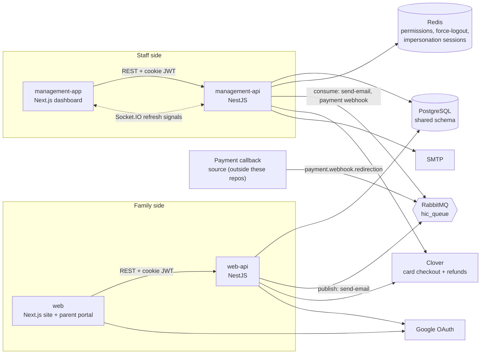

# Case Study: Hic School Management App

## Overview

Hic School Management App is a full-stack platform that runs the administration of an Islamic educational institution and gives families a self-service portal. It consists of four repositories: an internal Next.js management dashboard and its NestJS API, and a public Next.js website / parent portal with its own NestJS API. All four share one PostgreSQL data model.

For the high-level summary see [README.md](./README.md); for the feature inventory see [key-features.md](./key-features.md); for repo internals see [architecture.md](./architecture.md).

## Background and Problem

An institution that sells programs (courses), enrolls students into class sections, collects fees in one-time or installment form, and pays its teachers needs several systems working together: admissions, finance, academics, payroll, and parent communication. The signals in the codebase (installment schedules, early vs regular registration, per-child pricing, scholarship budgets, teacher payroll, proxy classroom access) show that these needs were being handled across many manual steps.

Typical pain points this kind of operation faces, and which the product is built to address:

- Staff need one place to manage programs, sessions, class sections, students, parents, attendance, exams, and grades instead of separate spreadsheets.
- Fee collection is complicated: multiple children per family, installments, add-on products, discounts, scholarships, partial refunds, and both online (card) and offline (cash, bank transfer, Zelle) payments.
- Money movements must be traceable: who changed what, when, and with what accounting effect.
- Different staff need different levels of access, and administrators sometimes need to see exactly what another user sees to support them.
- Parents expect to register, pay, and follow progress online without calling the office.

TODO: replace the bullets above with the owner's first-hand account of the institution's actual situation before the platform (the repository shows the system's shape, not the pre-existing process).

## Goals

Inferred from what was built:

1. Give staff a single, permission-controlled dashboard covering the full student and staff lifecycle.
2. Let parents self-serve: create an account, add children, register, pay online, apply for scholarships, and track attendance, grades, and homework.
3. Make payments reliable and auditable, with correct accounting entries for every payment, refund, salary, and expense.
4. Support flexible pricing (multi-child fee structures, installments, discounts, scholarships) without manual spreadsheets.
5. Keep sensitive operations safe: granular RBAC, audit logging, controlled impersonation, forced logout, and account lockouts.
6. Keep the UI responsive and in sync (real-time updates) while heavy work (emails, payment follow-up) runs asynchronously.

TODO: confirm or edit these goals with the actual business objectives.

## Solution

The solution is split into a staff side and a family side, each with its own frontend and API.

**Management side.** The management dashboard (Next.js App Router) is organised by domain in its sidebar: Academics, Students, Parents, Faculty, Events and Schedules, User Management, Finance, Communication, and Settings, plus personal pages (profile, my attendance, my proxy classes). The NestJS management API exposes about 55 controllers under a versioned `/api/v1` prefix, secured by a global JWT guard and a global permission guard.

**Family side.** The public site (Next.js) presents the school, program catalog, and events, and provides a parent dashboard with "My Children", "Admissions", and "Purchases and Fees". Its NestJS API handles parent authentication (email + Google OAuth), child management, registration, order and payment retrieval, scholarship applications, and read-only academic data.

**Shared back end.** Both APIs read and write the same PostgreSQL database. The management API owns schema migrations. RabbitMQ carries email jobs and payment-confirmation events, Redis holds ephemeral security state, and Socket.IO pushes lightweight "refresh" signals to open dashboards.

## Users and Roles

| User | Where they work | What they do |
|---|---|---|
| **Super admin / administrator** | management-app | Full access; manages roles, permissions, users, settings, can impersonate other users |
| **Accountant / finance staff** | management-app | Fees collection, refunds, expenses, payroll, reports |
| **Teacher** | management-app | "My Levels / My Classes / My Students", attendance, grading, homework, timetable; can grant or receive proxy access to sections |
| **Employee / other staff** | management-app | Access defined by assigned roles and direct permissions |
| **Parent / guardian** | web | Registers children, buys programs, pays (online), tracks orders, scholarships, attendance, grades, homework |
| **Prospective family (visitor)** | web | Browses programs and events before signing up |

Staff types in the data model are admin, teacher, employee, accountant, and other. What a staff member can actually do is not determined by type but by the union of permissions from their roles and any permissions assigned directly to them.

## System Architecture

Four deployable services plus shared infrastructure. The two frontends call only their own API. The APIs share the database. RabbitMQ links the web-facing flow to the management API's payment and email consumers.

Key points:

- The management API is the only service that consumes from RabbitMQ (email sending and payment-webhook processing). The web API publishes email jobs.
- Payment confirmation is event-driven: a Clover payment-callback event enters via RabbitMQ and is processed by the management API's payment-webhook service.
- Authentication is custom (Passport JWT in HttpOnly cookies), not an external identity provider.

## Key Technical Challenges and Decisions

### 1. Keeping money consistent across payments, refunds, and accounting

Order handling is the most complex part of the system (the fee service alone is roughly 2,400 lines). Decisions visible in code:

- **Transactions everywhere money moves.** Adding items, refunds, scholarship application, change-program, and payment confirmation use explicit `QueryRunner` or `dataSource.transaction` blocks.
- **Two-phase external refunds.** The refund flow loads and validates first (no external calls), performs card refunds through Clover, then commits DB changes. If the DB step fails after a card refund succeeded, the code rolls back and logs a high-severity message listing the Clover refund IDs so that an operator can reconcile.
- **Double-entry accounting.** Payments, refunds, salaries, and expenses create journal entries and ledger lines against a chart of accounts (cash, receivables, student payments, discounts allowed, refunds, salary and other expenses), inside fiscal periods that can be open or closed.
- **Derived totals.** Order totals are computed from typed line items (program, product, item, discount, scholarship, with refunded items linked to originals via a reference id) rather than stored as free-form numbers.
- **Discount absorption into installments.** When a discount is applied through the refund flow, pending installments are consumed from the last one backwards (cancelled if fully covered, otherwise reduced) before any cash is refunded.

### 2. Idempotent, retry-safe payment confirmation

Payment confirmation arrives asynchronously. The webhook service takes a pessimistic write lock on the payment, treats already-paid payments as a no-op, separates "mark paid and post accounting" from "complete registration and notify" so that the second step can be retried safely, and throws on purpose from the post-payment step so RabbitMQ redelivers. The consumer wraps handlers in timeouts (so a stuck handler cannot hold an unacked message past the broker's channel timeout), retries up to three times, and acknowledges outside the try block so that a failed ack cannot re-send an email that already went out.

### 3. Scholarships with a reserve-then-finalize lifecycle

A scholarship is a per-student, per-program-config entitlement with a review workflow (pending, under review, approved, rejected, cancelled). When applied to an order, it is first reserved (applied-at / order reference) and only finalized (used-at set, program-config used and remaining budgets updated) when the payment is confirmed in the webhook transaction. This prevents consuming a limited scholarship budget on an order that is never paid. A unique constraint on student and program config prevents duplicates.

### 4. Granular RBAC, migrated off an external identity provider

Authorization is slug-based: controllers declare required permissions, a global guard compares them with the user's effective permission set. The permission constants file documents a migration from a legacy Keycloak role scheme to database-backed roles and permissions, preserving provenance (each slug notes the legacy role it replaced) so that no real access was silently dropped. Effective permissions are cached in Redis, invalidated on change, and pushed to the user's open browser session through a WebSocket event, so permission changes take effect without re-login. The frontend mirrors the model with permission-guard components and hooks.

### 5. Safe admin impersonation

Support staff sometimes need to see what a user sees. Impersonation is implemented as a first-class, audited, time-boxed session:

- Only super admins can start it; the session lives in Redis for 15 minutes and is validated on every request.
- Effective permissions are the target's permissions capped by the admin's own (re-evaluated per request), and impersonation of administrators requires a super admin. Nobody can use it to gain access they lack.
- `@NoImpersonation()` marks endpoints that must never run while impersonating.
- Start and end are audited exactly once, even when several API instances run or the admin simply closes the tab (a per-minute sweeper closes abandoned sessions; a Redis `SET NX` claim makes the finalization idempotent).
- The identity of both parties is snapshotted so audit records stay accurate if users are later renamed or deleted, and every data-change audit row carries the impersonating admin.
- The UI shows a persistent banner with a countdown and an exit control.

### 6. Automatic audit trail

A TypeORM entity subscriber listens to all entities and records inserts, updates, deletes, and soft-deletes with old and new values (JSONB), user, IP, and impersonation actor, excluding sensitive fields and noisy tables. An interceptor carries request context into the subscriber so rows are attributed correctly without each service passing the user around.

### 7. Pricing model: multi-child fee structures and shared orders

Fee structures are keyed by number of children, registration type (early or regular), payment mode (one-time or installment), and installment count. A single order can cover several siblings, so one fee record can span multiple student registrations; amounts therefore have to be divided by the sharing count instead of summed per student. The parent registration endpoint validates that the number of participants matches the chosen fee structure.

### 8. Two APIs, one database

The public site and the admin dashboard have very different threat models and traffic patterns, so they are separate NestJS services, each with only the modules it needs (the web API exposes about 13 modules versus about 50 in the management API). Both map the same entities, and schema migrations are owned by the management API. The trade-off is entity duplication across the two codebases, which requires discipline to keep in sync; this is a natural place for a future shared package.

### 9. Asynchronous work and real-time UI without over-engineering

Emails and payment follow-up go through RabbitMQ with publish-retry on the producer side and bounded retries on the consumer side, so user-facing requests never wait on SMTP. For the UI, Socket.IO is used purely as a signalling channel: events carry no data and tell clients to refetch through the normal authenticated REST endpoints, which avoids putting sensitive data on the socket and avoids a second authorization path.

### 10. Session validity beyond token expiry

A JWT's expiry cannot reveal that an account was disabled, locked, or force-logged-out. The API therefore checks account status and a Redis force-logout flag on every authenticated request, and the parent site's Next.js proxy asks the API whether the token is still valid before rendering dashboard routes (failing open on network errors and skipping link prefetches so that a slow API does not sign everyone out).

## Outcome and Impact

What the code demonstrates is delivered:

- Four deployable services with Docker and Jenkins pipelines.
- 50+ NestJS modules and roughly 55 controllers in the management API; 75 mapped entities; 40+ database migrations; 170+ permission slugs; 35+ email templates.
- A complete admissions-to-payment-to-enrollment flow, including refunds, scholarships, and accounting entries.

Business impact is not measurable from the repositories. Fill in what you can substantiate:

- TODO: number of students / families / staff on the platform
- TODO: payment volume or share of fees collected online
- TODO: time saved in admissions, fee collection, or payroll processing
- TODO: reduction in manual reconciliation or support requests
- TODO: go-live date / current status
- TODO: testimonials or feedback from the institution

## What I Learned

Written as prompts the owner can edit; the technical themes below are supported by the code.

- Designing money flows: transactions, idempotency, locks, and what to do when an external side effect (a card refund) cannot be rolled back with the database.
- Modelling permissions as data (slugs, roles, direct grants) and keeping the UI, cache, and API consistent when they change.
- Building features that need to be safe by construction (impersonation capped by the actor's permissions, audited exactly once).
- Using a message broker for reliability: timeouts, retry headers, ack placement, and idempotent consumers.
- Evolving a system with a shared database across two services, and the cost of duplicated entity definitions.
- TODO: add personal lessons (what you would do differently, what surprised you, what you would refactor first).

## My Role and Contributions

> This section is a placeholder. The repositories do not say who built which parts. Tick what applies and replace the prompts with specifics.

- [ ] I was the sole developer / one of N developers (TODO: team size)
- [ ] My title / engagement type (TODO: e.g., full-stack developer, contract, employee)
- [ ] Time period I worked on it (TODO)
- [ ] Repos I contributed to:
  - [ ] management-app
  - [ ] management-api
  - [ ] web
  - [ ] web-api
- [ ] Areas I designed or built (cross-reference [key-features.md](./key-features.md) and keep only the bullets that are yours):
  - [ ] Admissions and registration
  - [ ] Fees, payments, refunds
  - [ ] Scholarships
  - [ ] RBAC / permissions
  - [ ] Impersonation / audit logging
  - [ ] Accounting ledger
  - [ ] Payroll and HR
  - [ ] Academics (attendance, exams, grading, homework, timetable)
  - [ ] Parent portal and public website
  - [ ] Messaging / email / real-time
  - [ ] DevOps (Docker, Jenkins)
- [ ] Decisions I led or influenced (TODO: 2-3 examples, e.g., "I proposed the reserve-then-finalize scholarship model")
- [ ] Problems I solved that I am proudest of (TODO)
- [ ] Collaboration (TODO: who I worked with: designers, product owner, other developers)
- [ ] Measurable results I can claim (TODO)
