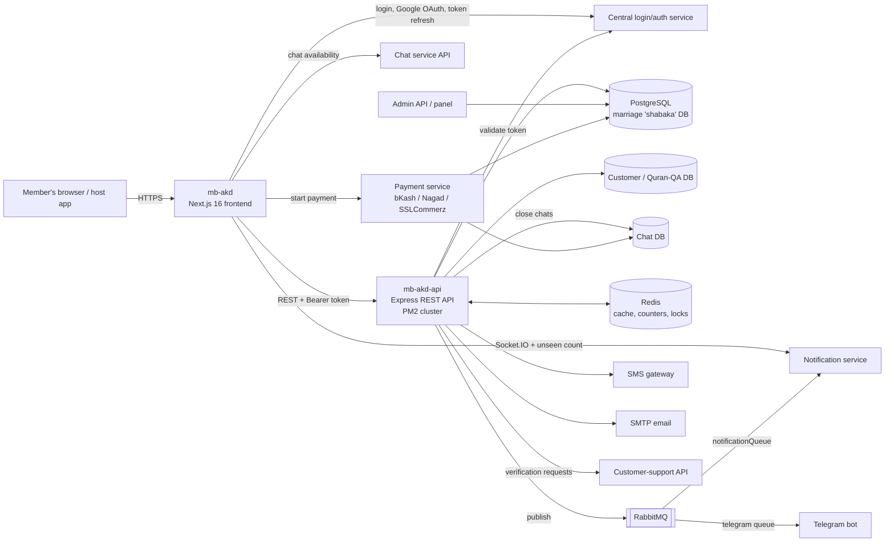
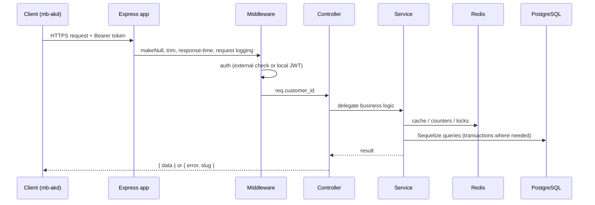
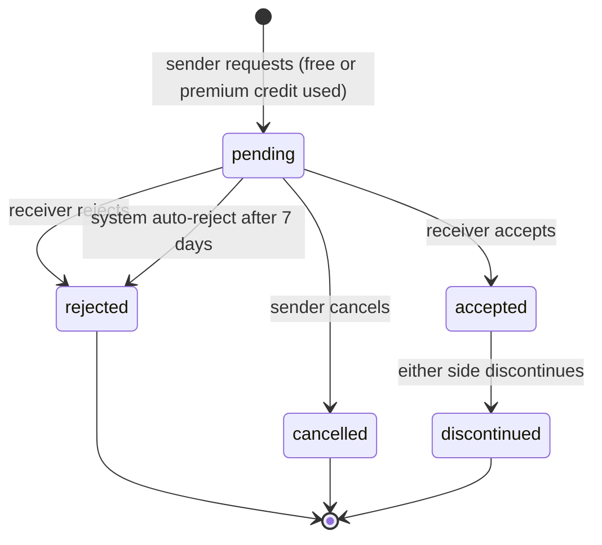

# Architecture

This document describes the two repositories that make up the Muslim Bangla Bibaho marriage product, and how they sit among the surrounding services. Everything below was read from the code and the API's own docs; items marked TODO are things the code does not reveal.

## System context



Key point: the marriage database is **shared by three services** (this API, an admin API, and a payment service). Several design decisions in the API (database triggers for the connection log, "run each SQL phase once", the same constants duplicated in four codebases) follow from that.

## Repository 1: `mb-akd` (frontend)

**Purpose.** Customer-facing web app: landing page, search, biodata view, biodata creation, dashboard, payments, notifications, statistics, help content.

**Stack.** Next.js 16.1 (App Router, Turbopack in dev on port 3003), React 19.2, TypeScript, Tailwind CSS 4, Radix UI + shadcn-style `components/ui`, Zustand, React Hook Form + Zod, Motion, Recharts, Socket.IO client.

### Trimmed folder structure

```
mb-akd/
├── next.config.ts              # remote image patterns, avatar CDN env
├── package.json
├── components.json             # shadcn config
└── src/
    ├── proxy.ts                # Next.js proxy: maintenance redirect, auth gate, search gender default
    ├── app/
    │   ├── layout.tsx          # root layout: providers, header, ads, support/chat buttons, GA tag
    │   ├── page.tsx            # landing page
    │   ├── @modal/(login)/     # parallel + intercepted route for the login modal
    │   ├── (pages)/
    │   │   ├── search/  biodata/[id]/  marriage-form/  dashboard/  settings/
    │   │   ├── biodata-fee/  payment/{bkash,success,fail,cancel}/
    │   │   ├── support-service/  individual-support-service/payment/
    │   │   ├── notifications/  successful-marriages/  claim/  reward/
    │   │   ├── instructions/  bibah-fozilot/  login/  success/  clear-storage/
    │   ├── development-in-progress/   # maintenance page
    │   ├── components/         # feature components
    │   │   ├── biodata/  BiodataCard/  BiodataStats/  MarriageStats/  SuccessfulMarriage/
    │   │   ├── Search/{Filter,InfiniteScrollSearchPage,SearchPage,FeaturedSection}/
    │   │   ├── Form/  CorrectionForm/  Dashboard/{connection-tab,favourite-tab,settings}/
    │   │   ├── Landing-Page/  instructions/  Stats/
    │   └── providers/          # Socket, Theme, theme URL bootstrap/sync
    ├── components/
    │   ├── ui/                 # design-system primitives (Radix-based)
    │   ├── shared/             # payment modals, login dialog, chat/support buttons, badges
    │   ├── auth/  layouts/  Advertisement/  motion/
    ├── services/
    │   ├── api/                # fetchWrapper, marriage-profile / chat / notification / login APIs
    │   ├── client-api/  payment/  connection.service.ts
    ├── store/                  # Zustand: user, form, search, connection, ads, socket, notifications, chat, floating widget
    ├── model/                  # Zod schemas (form, filters, login, report, correction)
    ├── hooks/  lib/  utils/  types/  constants/  data/  assets/
```

### Main modules

| Module | Responsibility |
|---|---|
| **Routing and gating** (`proxy.ts`) | Site-wide maintenance redirect, auth gate for protected pages, cookie capture of `app_id`/`type`, default opposite-gender search for owners |
| **Biodata form** (`components/Form`, `model/form.schema.ts`, `store/form.store.ts`) | Nine-step wizard with Zod validation and a persisted form store |
| **Search** (`components/Search`, `store/search.store.ts`, `utils/preference-filter-params.ts`) | Filters, chips, infinite scroll, preference-driven filtering, result caching |
| **Biodata detail** (`components/biodata`) | Section components, connection button/state machine, mark buttons, report, expectation-match table, chat widget |
| **Dashboard** (`components/Dashboard`) | Connection tabs, favourites, settings (inactive/delete, card display) |
| **Payments** (`services/payment`, `components/shared/*payment*`) | Gateway launcher, popup/postMessage handling, pending payment persistence, method catalog |
| **Realtime** (`providers/SocketProvider`, `store/useSocketStore`) | Authenticated Socket.IO client and notification badge |
| **Stats** (`components/BiodataStats`, `MarriageStats`, `Stats`) | Recharts dashboards and animated KPI cards |
| **Theming and i18n helpers** (`providers/theme-*`, `utils/helper.ts`) | Light/dark/system, URL-driven theme, Bangla numerals and text helpers |

### Data fetching and state

- A shared `fetchWrapper` plus a `getHeaders` helper attach the Bearer token; server components (for example the successful-marriages page) fetch on the server, while interactive features use client-side services.
- Zustand stores hold the user session, the multi-step form, the search result cache (persisted), connection-limit info, ads, socket state, chat state, and notification counts.
- A `UserInfoRestore` layout component rehydrates user and biodata data on load.

### Auth approach

Token-based. Login happens against a central login API (Google OAuth redirect and an email/OTP flow); the access token lives in a cookie readable on both server and client, a refresh endpoint is called with a single-flight mutex, and the Socket.IO connection authenticates with the same token. Some client-side data is stored encrypted in `localStorage`.

### Deployment

- No Dockerfile, CI file, or hosting config was found in the repo; the README is the unmodified `create-next-app` text. TODO: describe actual hosting and CI/CD.
- Runtime configuration is entirely through `NEXT_PUBLIC_*` environment variables (API base URLs for the marriage, login, notification, chat, and customer-support services, CDN URLs, bKash script URL) plus a server-only `DEVELOPMENT_IN_PROGRESS` flag.
- Both `package-lock.json` and `pnpm-lock.yaml` are present.

### Third-party integrations (frontend)

Central login service (including Google OAuth), notification service (Socket.IO + HTTP), chat service API, customer-support service, payment gateways via the payment service (SSLCommerz, bKash, Nagad, plus offline methods), country/ads API, Google Analytics, and a CDN for avatar images.

## Repository 2: `mb-akd-api` (backend)

**Purpose.** REST API for the marriage domain: biodata CRUD and search, connections, favourites/dislikes, reports, call-support purchases, statistics, successful marriages, biodata-fee rules, and scheduled maintenance jobs.

**Stack.** Node.js, Express 4, Sequelize 5 (PostgreSQL via `pg`; `mysql2` is also listed as a dependency), Redis, RabbitMQ (`amqplib`), `cron`, Winston, Firebase Admin, nodemailer. Process manager: PM2.

### Trimmed folder structure

```
mb-akd-api/
├── app.js                      # Express bootstrap, CORS, logging, cron start, RabbitMQ consumer
├── ecosystem.config.js         # PM2 cluster config (8 instances)
├── CLAUDE.md  README.md        # architecture notes, favourites-migration runbook
├── docs/
│   ├── backend-*.md            # per-feature SQL, rationale, rollout (fee, connection log, chat, support)
│   └── superpowers/{specs,plans}/   # fee-deactivation + reminders design and plan
├── test/                       # node:test unit tests (deactivation planning)
└── src/
    ├── config/                 # DB + Redis configs per environment (and service-account files)
    └── app/
        ├── routes/             # index.js -> api.js (customer) and admin.js
        ├── middleware/         # auth-customer, auth-customer-local (JWT), auth-user, role, makeNull, trim
        ├── controllers/api/    # marriage-profile, connection, favourite, not-interested, report,
        │                       # biodata-fee, chat, individual-contact-support, avatar, external, migration
        ├── services/           # business logic (see below)
        ├── models/
        │   ├── shabaka/        # marriage domain models
        │   ├── quran/  pg/mb-customer/   # customer/account models (shared platform)
        │   └── chat/           # chat service tables the API writes to
        ├── constants/          # fee tiers, connection windows, chat enums
        └── utils/              # logger, Bangla numerals, divisions/districts, education options
```

### Main modules (services)

| Service | Responsibility |
|---|---|
| `connection-service`, `connection-status-service`, `connection-log-service` | Connection lifecycle helpers, unified status resolution, timeline reads |
| `connection-refund-service` | Cron logic: auto-reject stale requests, refund premium credits, call-support grace |
| `package-service` | Free/premium connection credit allocation and validation |
| `biodata-fee-service`, `biodata-deactivation-service`, `biodata-deactivation-plan` | Fee tiers, change pricing, overdue deactivation, closure/refund planning (pure functions are unit-tested) |
| `marked-biodata-service`, `marked-biodata-migration-service` | Favourite/dislike marks and the one-off data migration |
| `expectation-match-service` | Builds the SQL expression for the reverse expectation match |
| `profile-score-service` | Responsiveness score from system-rejection ratio |
| `biodata-stats-service` | Aggregated demographic stats, Redis-cached |
| `chat-service`, `support-involvement-service`, `individual-contact-support-service` | Call-support purchase and chat/ support-status coordination |
| `redis-service` | Cache, counters, distributed lock, view/last-visit flush |
| `notification-center-service`, `notification-service`, `message-queueing-service` | In-app notification payloads, FCM, RabbitMQ publish/consume |
| `sms-service`, `email-service`, `telegram-notification` | Outbound channels |
| `cron-service` | Midnight and 1 AM jobs |

### API surface (grouped)

- `/marriage-profile` (create, read, update, delete, activate, inactive), `/marriage-profiles` (search), `/marriage-profiles/stats`, `/marriage-profile/:id`
- `/marriage-profile/successful-marriage` (create, list, details, stats, reward status)
- `/connection/*` (create, accept, reject, cancel, discontinue, lists, timeline, request-limits)
- `/make-favourite`, `/favourites`, `/delete-favourite/:id`, `/not-interested`
- `/report`, `/avatar`, `/biodata-fee/change-intent`, `/individual-contact-support-service`, `/chat/unread`, `/verification-requests`
- `/migrate/marked-biodatas` (+ `/status`), guarded by a secret key rather than customer auth
- `/admin/...` (admin-authenticated; currently one route)

### Data model highlights

All tables use soft delete (`deleted_at`) and snake_case columns with camelCase model attributes.

| Entity | Notes |
|---|---|
| `marriage_profiles` | Core entity, 100+ columns: personal, education, job, family, religious practice, partner expectations (many array-typed), location IDs, status (`active`/`inactive`/`blocked`), verification and support flags, `biodata_fee_status` (`due`/`paid`/`exempt`), `inactivated_reason` (`self`/`biodata_fee`/`admin`), score, view and last-visit counters. Sequelize scopes (`list`, `view`, `premiumView`) control which fields each audience sees |
| `connections` | Sender and receiver biodata IDs, status (`pending`/`accepted`/`cancelled`/`rejected`/`discontinued`), package type (`free`/`premium`) and ID, `rejected_by`, `discontinued_by`, `call_support_id`, `support_status` |
| `connection_logs` | Append-only history written by a Postgres trigger, one row per status change with actor |
| `connection_packages` | Per-customer free/premium credit buckets with limits and expiry |
| `marked_biodatas` | Favourite/dislike marks keyed by marker biodata with a partial unique index (one live mark per pair) |
| `individual_contact_support_services` | Per-connection assisted-contact purchases with status |
| `successful_marriages` | Groom/bride biodata IDs, marriage date, review status, coupon code |
| `reports`, `refund_logs`, `avatars`, `divisions`/`districts`/`upazilas` | Moderation, refund audit, avatar catalogue, geography |
| Chat DB tables (`conversations`, participants, `marriage_biodata_links`, chat users) | Owned by the chat service; this API only closes chats |

### Auth approach

Customer routes are protected by a Bearer-token middleware. In non-production it delegates validation to an external auth service; in production it verifies the JWT locally with a configured secret. Admin routes use a separate middleware that validates against an admin-auth service. The migration endpoints use a shared secret query key and refuse to run when it is unset. Customer login itself is not implemented in this API; accounts and sessions live in the shared customer platform (the API only holds read models of customers, and a legacy admin-user model that hashes passwords with bcrypt).

### Scheduled jobs

| Time | Job |
|---|---|
| 00:00 | Flush Redis view counters and last-visit timestamps to PostgreSQL |
| 01:00 | Refund and auto-reject stale connection requests (premium, free, call-support); deactivate overdue unpaid biodatas |

The three refund/auto-reject jobs and the biodata-fee deactivation job each take a Redis lock, so only one PM2 instance processes them at a time.

### Deployment

- PM2 in cluster mode with eight instances (`ecosystem.config.js`); production logs go to a PM2 log directory with daily rotation.
- Configuration through environment variables per `NODE_ENV` (development, staging, production).
- Release procedures are written down per feature (SQL to run once against the shared database, deployment order, maintenance-mode toggle on the frontend, verification queries, rollback).
- No Dockerfile or CI file found. TODO: add hosting details.

### Third-party integrations (backend)

Central customer/admin auth service, SMS gateway, SMTP email, Firebase Cloud Messaging (two service accounts for Android and iOS), RabbitMQ, Redis, Telegram (via a queue), customer-support API, the chat service's database, and the payment service (indirect: it writes payment results to the shared database and the API reads them).

## Request lifecycle (API)



## Connection state machine



Every transition is captured in `connection_logs` by a database trigger, and any transition out of `pending` closes the linked chat if the connection had call support.
