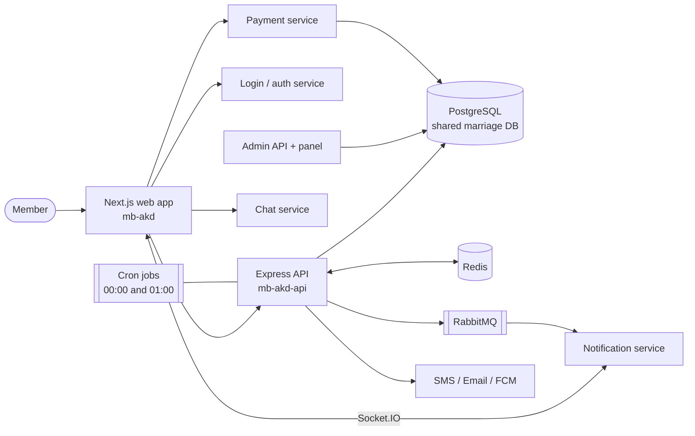

# Case Study: Muslim Bangla Bibaho

*A Bangla-first Muslim matrimony platform built around consent, trust, and a fee-based quality gate.*

> Items marked `TODO:` are details the source code cannot tell and that only the owner can supply (numbers, dates, links, personal role). Nothing in this document is an invented metric.

---

## Overview

Muslim Bangla Bibaho is a matrimony service for Bengali-speaking Muslims, built as a Next.js web application (`mb-akd`) on top of a Node.js/Express REST API (`mb-akd-api`). Members publish a structured *biodata*, search the directory of other biodatas, and use a request-and-consent flow to unlock each other's full details. Optional paid services add verification and assisted contact through a support team and an in-app chat.

The system is one product inside a wider Muslim Bangla ecosystem: authentication, payments, chat, notifications, administration, and customer support are handled by sibling services that this product integrates with, and the marriage database is shared with the admin and payment services.

| | |
|---|---|
| Frontend | `mb-akd` - Next.js 16, React 19, TypeScript, Tailwind 4 |
| Backend | `mb-akd-api` - Express, Sequelize, PostgreSQL, Redis, RabbitMQ |
| Repo history | March 2025 to November 2026 (frontend, about 1,300 commits), September 2025 to November 2026 (API, about 450 commits). Multiple contributors |
| Live URL | TODO: add |

## Background & Problem

Arranged and semi-arranged marriage search in Bangladeshi and diaspora communities has traditionally relied on family networks, matchmakers, and the *biodata*: a standard, text-heavy marriage resume. Online matrimony for this audience has specific needs that general dating or matrimony products often do not meet:

- **Religious and cultural fit matters as much as demographics.** Prayer habits, dress, school of thought, hafiz status, views on a second wife, mahram observance, and family religious practice are first-class selection criteria alongside age, height, education, and profession.
- **Privacy and propriety.** The product withholds full details and contact information until a request is accepted, which suggests that open contact is deliberately avoided.
- **Trust and quality.** The product's own design notes record that free biodata creation let fraudulent, fake, and test biodatas onto the platform, eroding trust.
- **Language and access.** The UI is Bangla-first with Bangla numerals, and the code treats expatriate members (outside Bangladesh and India) as a distinct segment with their own pricing.
- **Payment diversity.** Local wallets (bKash, Nagad), card gateway (SSLCommerz), and offline or international routes (bank transfer, PayPal, Zelle and others) for members abroad.

## Goals

Derived from the behaviour built into the code and the API's design documents:

1. Let a member describe themselves and their partner expectations in a structured, searchable form.
2. Make discovery efficient: rich filtering, personalised "my preferences" search, and a visible measure of how well a candidate's expectations match the viewer.
3. Protect privacy through consent: full information is released only after a request is accepted, and unanswered requests expire.
4. Reduce fake and low-quality profiles with a one-time, income-tiered biodata fee and a phone-verification path.
5. Offer a path for members who want assistance: a paid, per-request support service with an agent and a private chat.
6. Keep members informed in real time (in-app, push, SMS) without exposing unnecessary data.
7. Show social proof (statistics and successful marriages) and encourage reporting of marriages through a reward claim.
8. Operate safely on a database shared with other services, with careful migrations and automated cleanup.

## Solution

**Biodata as the core entity.** A nine-step wizard collects personal, educational, professional, location, family, religious, expectation, avatar, and proposal details. The API stores them in a single `marriage_profiles` model with scopes that decide which fields each audience may read. Members choose an illustrated avatar rather than uploading a photo.

**Discovery.** A filterable directory, with a persisted, infinite-scroll client and an "according to my preferences" shortcut. A reverse expectation match shows whether the viewer satisfies a candidate's expectations, computed in SQL so it can be used to sort the full result set.

**Consent-based connections.** Members send requests with a free or premium credit, the receiver accepts or rejects, and the system auto-rejects stale requests after seven days and refunds premium credits. Each state change is recorded for a per-pair timeline, and the UI surfaces the state consistently on cards, detail pages, and dashboards.

**Monetisation and quality gate.** New biodatas stay inactive until a one-time fee is paid; fee tiers follow the member's family status with a flat rate for expatriates. Existing paying customers were grandfathered, and a deadline job deactivates remaining unpaid biodatas while cleanly closing their pending connections.

**Assisted contact.** A per-connection support purchase links a payment to a connection, opens a private chat when paid, and closes it automatically when the request is resolved.

**Platform.** Notifications flow through RabbitMQ to a shared notification service and the client over Socket.IO; Redis handles caching, counters, and locks; scheduled jobs handle nightly flushes and expiries.

## Users & Roles

| Role | What they do | Where it shows in code |
|---|---|---|
| **Visitor (anonymous)** | Browses the public directory and limited biodata views, reads guidance, sees statistics and successful marriages | Public routes (`/marriage-profiles`, `/marriage-profile/:id`, stats) |
| **Member with biodata** | Creates/edits biodata, searches, sends and answers requests, marks favourites/dislikes, reports profiles, pays fees and buys services | Customer-authenticated routes |
| **Member without biodata** | Can log in and browse, but is prompted to create a biodata before connecting or marking | "Make a biodata first" checks in the API and UI |
| **Guardian or family member** | The biodata includes guardian-consent and family fields. TODO: confirm whether guardians use the app directly | `guardians_consent`, family sections in the model |
| **Support agent / admin** | Handles call-support requests, verification, moderation, fee reminders, successful-marriage review | Admin API routes and `support_status`; admin panel is a separate repo (not covered here) |
| **System (cron / services)** | Auto-rejects requests, refunds credits, deactivates overdue biodatas, flushes counters | `cron-service`, `rejected_by = 'system'` |

## System Architecture

The frontend is a Next.js App Router application that talks to the marriage API with a Bearer token, to a central login service for authentication, to a notification service over Socket.IO, to a chat API for chat availability, and to a payment service for gateway checkout. The marriage API is a layered Express service (routes, controllers, services, Sequelize models) running as a PM2 cluster. It uses PostgreSQL (marriage, customer, and chat databases), Redis, RabbitMQ, an SMS gateway, SMTP, and Firebase push. A detailed breakdown is in [architecture.md](architecture.md).

## Key Technical Challenges & Decisions

These are drawn from the code and the API's design docs; each is a concrete talking point.

### 1. Evolving a schema shared by three services

The marriage database is read and written by this API, an admin API, and a payment service. Changes therefore follow a deliberate pattern: SQL is applied **once** to the shared database, model changes are mirrored in all repos, and runbooks record deployment order, a maintenance-mode window, verification queries, and rollback.

*Example:* migrating `favourites` into `marked_biodatas` re-keyed marks from customers to biodatas and merged a separate dislike table. The migration runs as an idempotent, batched background job behind a secret key, with 202/409/503 semantics, and builds a partial unique index at the end to enforce "one live mark per pair". The documentation notes the data impact in advance (most legacy favourites belonged to owners who had deleted their biodata) so the trade-off was explicit before running on live.

### 2. Capturing connection history without trusting every writer

Connection status was overwritten in place, and cancellations and auto-rejections soft-delete rows, so the history was lost. Because three services write to the table, the API adds an append-only `connection_logs` table filled by a **Postgres trigger** rather than application code. The trigger swallows its own errors so logging can never break a real write, and the app only reads from it for the pair timeline.

### 3. Safe scheduled jobs on a multi-instance deployment

The API runs as an eight-instance PM2 cluster, so cron jobs would fire on every instance. The refund, auto-reject, and fee-deactivation jobs acquire a **Redis distributed lock** before working, and view counters use Redis increments flushed nightly under a lock to avoid races and per-request write amplification.

### 4. Fee enforcement that behaves like the manual flow

An early version of the overdue-fee job only flipped `status = inactive`, leaving pending connections stuck because the counterpart could not act on an inactive biodata. The design spec replaces that with the same inactivation flow as self-deactivation: close pending connections, notify the counterparts, and refund the counterpart's premium credit only in unambiguous cases (premium request sent *to* the unpaid biodata by a sender who is not itself fee-due, so the result does not depend on processing order). The decision logic is extracted into pure functions (`planClosure`, `planDeactivation`) and covered by unit tests, with resume support for a partially failed run.

### 5. Ranking by "do I meet their expectations?" at query time

Computing a reverse match client-side would need every candidate fetched in full and could not sort across pages. The API expresses the same rules as a SQL expression added to the list query, covering education ladders for different mediums and complexion aliases. The rules are kept in step with a client utility so the percentage on the card and in the detail table are the same number.

### 6. Price and constant parity across codebases

Fee tiers, package IDs, and the deadline exist in the API, the payment service, the admin API, the admin UI, and the frontend. The code carries explicit "keep in step" comments, and the docs name every copy, an honest acknowledgement of a duplication cost that a shared package or config service would remove.

### 7. Reliable payment return across platforms

The payment launcher opens a popup on desktop and redirects the same tab on iOS and macOS, where popups and message passing are unreliable. It persists pending payment state, accepts both `postMessage` and a channel signal, guarantees a single outcome per payment, and validates message origin against the page's own origin.

### 8. Chat integration without webhooks

The API closes the chat of a connection that has left `pending` by writing directly to the chat service's database, while the payment service opens chats. The design avoids a webhook chain, never lets a chat failure break an accept or reject, and documents the trade-off (live socket events are bypassed, so the chat service re-checks conversation status on every send).

### 9. Privacy-aware statistics

Public statistics group by age band, profession, education, region, and country, with categories below a minimum count folded into "others", and results cached for an hour. The frontend renders them with animated KPI cards and charts.

### 10. Operating with a maintenance switch

A server-only `DEVELOPMENT_IN_PROGRESS` flag makes the Next.js proxy redirect every page to a no-cache 307 maintenance page and strips API-backed chrome from the layout, giving a safe window for database migrations.

## Outcome & Impact

The repositories show a feature-complete matrimony flow in active development, but they contain no usage or business data. Fill in only numbers you can stand behind.

| Metric | Value |
|---|---|
| Registered members | TODO |
| Biodatas published | TODO |
| Connection requests sent / accepted | TODO |
| Successful marriages recorded | TODO |
| Biodata-fee conversion or revenue | TODO |
| Monthly active users | TODO |
| Performance or reliability improvements | TODO |

Observable engineering outcomes (from the code and docs, not business results): an explicit connection lifecycle with auditable history, automated expiry and refunds, a fee-based quality gate with grandfathering and a deadline job, a documented migration approach for a shared database, and statistics and success stories surfaced to build trust.

## What I Learned

Suggested themes, grounded in what this codebase demonstrates. Edit to reflect your own experience.

- Designing for **trust and consent** in a sensitive domain changes the data model, not just the UI (scopes by audience, request lifecycle, expiry).
- Working on a **shared database** demands migration discipline: idempotent jobs, maintenance windows, partial indexes, and rollback plans written before running anything.
- Putting **history in the database** (a trigger) is more reliable than relying on every service to log.
- **Locks and idempotency** matter as soon as an app runs as a cluster with scheduled jobs.
- Keeping **business rules identical across services** is costly; shared constants or a config service would reduce drift.
- **Localisation is more than translation**: Bangla numerals, mixed Arabic/Bangla text, region-aware payment methods, and culturally specific profile fields.
- Writing **design notes and runbooks next to the code** made multi-service releases less risky.
- TODO: add your own lessons.

## My Role & Contributions

> **Owner: fill this section in.** Delete anything that does not apply. Use first person. Cross-reference [key-features.md](key-features.md) for the specifics you can claim.

**Role / title:** TODO

**Team size and composition:** TODO (the git history of both repos shows several contributors)

**Duration / dates of involvement:** TODO

**Repos I worked in:**
- [ ] `mb-akd` (frontend)
- [ ] `mb-akd-api` (backend)
- [ ] Other services (admin, payment, chat): TODO

**Areas I owned or contributed to** (tick all that apply):
- [ ] Authentication, session, and token refresh
- [ ] Biodata creation wizard and validation
- [ ] Search, filters, and the preference/expectation match
- [ ] Biodata detail page and connection flow
- [ ] Dashboard (connections, favourites, settings)
- [ ] Biodata fee, pricing, and deadline enforcement
- [ ] Payment gateway integration and payment return handling
- [ ] Call-support purchase and chat integration
- [ ] Notifications (Socket.IO, push, SMS, RabbitMQ)
- [ ] Statistics dashboards and successful-marriage/reward flow
- [ ] Redis caching, cron jobs, and distributed locks
- [ ] Database design, migrations, and runbooks
- [ ] Theming, localisation, and UI components
- [ ] Testing, logging, and operations
- [ ] Code review, mentoring, or technical leadership

**Specific accomplishments (in my words):**
1. TODO: what I built, the problem it solved, and the result
2. TODO
3. TODO

**Technologies I used or learned on this project:** TODO

**Impact I can verify:** TODO (only include figures you can source)
