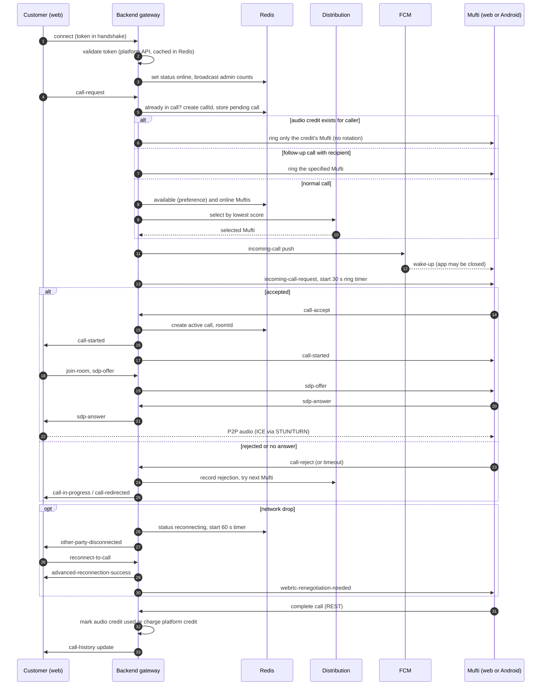
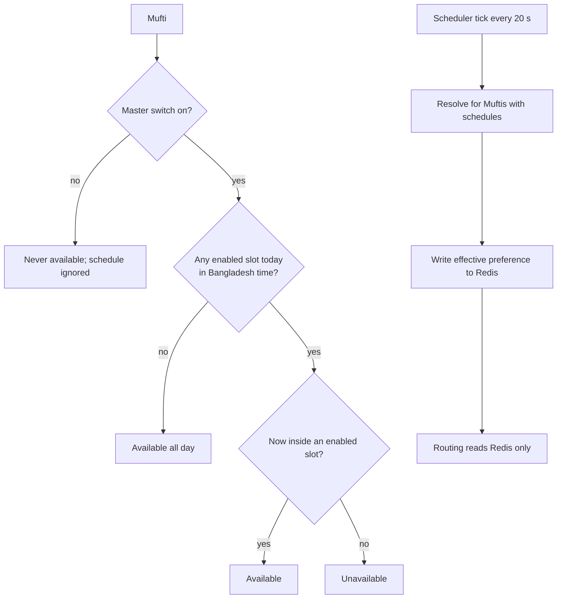

# Architecture

Two repositories make up the system. A native Android receiver app for Muftis also exists but is not in these repos; it is covered only through the integration docs in the frontend repo.

| Repo | Role | Stack |
|---|---|---|
| `mb-call-back` | Signalling, routing, presence, history, notifications | NestJS 11, Socket.IO 4, TypeORM, Postgres, Redis, FCM |
| `mb-call-react-front` | Web client for customers (callers) and Muftis (receivers) | React 19, Vite, Zustand, Tailwind 4, shadcn/ui |

---

## 1. Backend: `mb-call-back`

### Purpose

A single NestJS process that exposes REST endpoints and a Socket.IO gateway. It authenticates users against the platform's auth API, routes call requests to Muftis, relays WebRTC signalling, tracks presence and call state in Redis, persists call history in Postgres and sends FCM notifications. Audio never passes through it.

### Folder structure (trimmed)

```
mb-call-back/
├── docs/
│   ├── 01-build-call-service.md        # design prompt: extract signalling as a multi-tenant service
│   ├── 02-integrate-call-service.md    # design prompt: host-app integration
│   ├── session-feature-plan.md         # design plan (not implemented in src)
│   ├── session-feature-frontend.md     # frontend contract for the planned feature
│   └── migrations/                     # hand-run SQL for production
├── src/
│   ├── main.ts                         # bootstrap: validation pipe, CORS, exception filter, Winston
│   ├── app.module.ts                   # three TypeORM connections + feature modules
│   ├── config/                         # database + redis config
│   ├── common/
│   │   ├── availability/               # pure schedule validation/resolution (+ spec)
│   │   ├── enums, interfaces, filters, logger, middleware
│   ├── database/entities/              # CallHistory, AudioCredit, CustomerPreference, Chat*
│   │   └── pg/mb-admin, pg/mb-customer # mapped entities from the other platform databases
│   ├── call-distribution/              # priority scoring service + tuning/inspection controller
│   ├── types/                          # socket typings
│   └── modules/
│       ├── auth/                       # token validation (platform API), REST guard
│       ├── socket/
│       │   ├── socket.gateway.ts       # connection, presence, reconnection, Redis adapter
│       │   ├── handlers/               # customer (calls), room (SDP/ICE), chat (dormant)
│       │   ├── services/               # call-manager, availability-scheduler, status-health-check
│       │   └── helpers/                # admin-status broadcaster
│       ├── call-history/               # controller, service, DTOs, mufti-assignment service
│       ├── customer/                   # preference, availability, online-users
│       ├── mufti/                      # Mufti directory (role-based)
│       ├── audio-credit/               # audio credit lookup and consumption
│       ├── notification/               # FCM v1 push
│       ├── redis/                      # Redis client, pub/sub, status, call keys
│       └── chat/                       # REST chat (socket handler not wired)
├── ecosystem.config.js                 # PM2
└── test/
```

### Main modules

| Module | Responsibility |
|---|---|
| `SocketModule` | Gateway, call handlers (`call-request`, `call-accept`, `call-reject`, `call-cancel`, `leave-call`, `reconnect-to-call`, `get-call-status`, `mark-call-completed`, `mark-call-awaiting`, `call-quality-feedback`, `ping`), room handlers (`sdp-offer`, `sdp-answer`, `ice-candidate`, `mute-audio`, `unmute-audio`, `join-room`, `leave-room`) |
| `CallManagerService` | Call IDs, pending/active call state in Redis, disconnection and reconnection logic, force-end, batched persistence |
| `CallDistributionModule` | Priority scoring and admin REST endpoints to inspect and tune it |
| `AvailabilitySchedulerService` | 20-second tick that applies schedules, guarded by a Redis lock |
| `StatusHealthCheckService` | 30-second sweep that repairs inconsistent presence keys |
| `CallHistoryModule` | History queries, completion/awaiting, Mufti assignment, analytics summary |
| `CustomerModule` | Master availability switch, weekly schedule API, online-users list |
| `MuftiModule` | Lists users with the "Masala Call Receiver" role and whether each could ring now |
| `AudioCreditModule` | Finds the oldest unused credit for a caller, marks credits used |
| `NotificationModule` | FCM v1 pushes (incoming call, missed call, assigned, "Mufti online") |
| `RedisModule` | Client wrapper, Socket.IO adapter factory, key helpers |

### Data model highlights

- **`call_histories`** (call DB): caller and recipient IDs and names, type (`payment`, `donation`, `question`), call `status` (pending, completed, awaiting, rejected, cancelled, missed, timeout, disconnected), separate `admin_status` (pending, completed, awaiting), start/end/duration, `call_id` and `room_id`, rejection and cancellation reasons, reconnection attempts, JSON metadata, and a JSONB snapshot of caller and recipient. It links to an audio credit by ID only (no FK).
- **`audio_credits`** (call DB): caller, optional recipient (null means normal distribution), `assigned_by_id`/`assigned_by_name` for Mufti-to-Mufti hand-over, credit amount and type, `used_at`. Cross-database references are deliberately stitched in application code.
- **`customer_preferences`** (call DB): one row per customer with the master `preference` (available, unavailable, dnd), `fcm_token`, and a JSONB `availability` weekly schedule (`sun..sat`, each a list of `{start_time, end_time, enabled}` in Bangladesh time).
- **`chat_rooms`, `chat_messages`**: two-party chat storage, currently unused at runtime because the socket handler is disabled.
- **Mapped external entities**: `User`, `Role`, `UserRole` (admin DB) and `Customer`, `Address`, `Device`, `Credit` (customer DB), used for role and profile lookups. The admin and customer connections have `synchronize: false`.
- **Redis keys (live state)**: per-customer status and socket ID, current-call keys by call and by customer, pending call IDs, tried-admin lists, middleware-info cache keyed by token, distribution counters (`call_dist:<date>:...`) and the scheduler tick lock.

### Realtime and signalling approach

- Transport: Socket.IO with the Redis adapter so several instances share rooms. If Redis is not ready after retries, the gateway runs in single-instance mode.
- Connection: the token arrives in the handshake query. The gateway first checks a Redis cache of the validated profile and otherwise validates with the platform auth API, then registers the socket, marks the user online and broadcasts admin counts.
- Signalling: SDP and ICE events are relayed to the call's room with sender metadata. No media or STUN/TURN is handled server-side (ICE servers are configured in the browser).
- Timers: 30-second ringing timeout, 30-second wait for an offline Mufti to connect, 60-second reconnection window, 5-second persistence batching, 20-second scheduler tick, 30-second health check.
- Events pushed to clients include `customer-info`, `incoming-call-request`, `call-started`, `call-accepted`, `call-rejected`, `call-cancelled`, `call-timeout`, `call-ended`, `call-in-progress`, `waiting-for-customer`, `no-customers-available`, `not_enough_credit`, `audio-credit-recipient-unavailable`, `audio-credit-updated`, `call-redirected`, reconnection events (`other-party-disconnected`, `other-party-reconnected`, `advanced-reconnection-success`, `webrtc-renegotiation-needed`), `admin-status-update`, and `call-history` updates.

### Auth approach

- No local user store or JWT issuing. Sockets and the REST guard validate the bearer token by calling the platform auth API (`get-customer-for-voice-call` for sockets, `get-user-info` for REST).
- Role: Mufti status is the `is_admin` flag from the platform profile; the Mufti directory uses the "Masala Call Receiver" role from the admin DB.
- Credit eligibility is computed on connect (admin, payment, donation or not available) and used to emit `not_enough_credit`.
- Note: several controllers (distribution tuning, much of the call-history API) have no guard applied in the code. Treat as a hardening follow-up before describing the API as secured.

### Deployment

- PM2 process defined in `ecosystem.config.js` running `dist/main.js` on a fixed port argument. Port also defaults via `PORT` env.
- Configuration is environment driven (`.env`): Postgres hosts for three databases, Redis, platform auth URL, Firebase credentials.
- Entity auto-sync only when `NODE_ENV=development`; production schema changes are applied via the SQL scripts in `docs/migrations/`.
- Cloud/provider and CI/CD: TODO: owner to confirm (no pipeline file was found in the repo).

### Third-party integrations

- Firebase Cloud Messaging via `firebase-admin` and FCM v1.
- Platform auth/billing API (token validation and credit charging).
- Redis, PostgreSQL.

---

## 2. Frontend: `mb-call-react-front`

### Purpose

A single-page web client used by both roles. A customer places and manages a call; a Mufti toggles availability, edits a schedule, receives calls, and reviews and hands over calls. It replaces an earlier Angular implementation (code comments reference the Angular services it mirrors).

### Folder structure (trimmed)

```
mb-call-react-front/
├── android-*.md, audiocall-v2-*.md,
│   web-backend-vs-android-*.md          # integration and parity docs
├── src/
│   ├── main.tsx, App.tsx                # routes: / and /call, /availability, /error
│   ├── pages/                           # CallPage, AvailabilityPage, ErrorPage
│   ├── components/
│   │   ├── call/                        # call UI: controls, dialogs, banners, Mufti tools
│   │   └── ui/                          # shadcn/ui primitives
│   ├── stores/                          # auth, socket, webrtc, call (Zustand)
│   ├── services/                        # availability, call-history, mufti (Axios)
│   ├── utils/                           # availability (mirror), cookies, support URL
│   ├── types/                           # call, availability, user
│   └── config/env.ts                    # VITE_* environment
├── vite.config.ts                       # React + Tailwind plugins, "@" alias
└── package.json
```

### Main modules

| Module | Responsibility |
|---|---|
| `call.store.ts` (about 2,000 lines) | Orchestrates the call state machine (idle, calling, incoming, connecting, reconnecting, in-call, ending), history, availability toggle, dialogs, poor-connection monitor |
| `socket.store.ts` | Creates the Socket.IO connection (WebSocket then polling fallback) and exposes server events as store state |
| `webrtc.store.ts` | Peer connection, media streams, offer/answer, ICE, ICE restart, speaker and microphone mode, mute |
| `auth.store.ts` | Reads and writes the session from cookies |
| Pages | `CallPage` (customer and Mufti views), `AvailabilityPage` (schedule editor), `ErrorPage` |
| `utils/availability.ts` | Client mirror of the backend schedule logic |

### Data and state highlights

- Server state arrives as socket events; REST is used for history, preference, availability and Mufti list.
- Session is stored in cookies (`token`, `customer`), with a cross-subdomain cookie domain in production builds.
- Local storage holds only the instruction-dialog timestamp.
- Environment values are build-time `VITE_*` variables (API URL and a Quran/Hadith API URL declared in config).

### Realtime and signalling approach

The client connects with the token in the handshake query, listens to the full set of call, room and reconnection events, and sends `call-request`, `call-accept`, `call-reject`, `call-cancel`, `leave-call`, `reconnect-to-call`, SDP and ICE events. It tracks reconnection attempts against a maximum, uses ICE-restart offers during recovery, and restarts a connecting timer (about 45 seconds while calling) on each redirect event so rotation does not trigger a false failure.

### Auth approach

The platform issues the token; the host page opens this app with a `token` query parameter. The client stores it in a cookie, sends it as a bearer header on REST calls, and as a query value on the socket. Missing token redirects to `/error`.

### Deployment

Static Vite build (`tsc -b && vite build`) suitable for any static host. Hosting target: TODO: owner to confirm. Production cookie domain implies a `muslimbangla.com` subdomain deployment.

### Third-party integrations

- STUN/TURN relay service for ICE (credentials appear in client source; see the notes below).
- Customer-support site deep link (token and context parameters).
- Web browser APIs: WebRTC, `getUserMedia`, `enumerateDevices`, `setSinkId`.

---

## 3. Call flow (end to end)



## 4. Availability resolution



---

## 5. Things to verify or harden before publishing

These were observed while reading the code. They are listed for accuracy and for the owner's judgment; they are not claimed as features.

- **Secrets in source.** The backend repo contains a Firebase service-account JSON under `src/config/`, and the frontend source contains TURN credentials. The Firebase file is tracked in git in the backend repo, so consider rotating it and moving it out of version control. Do not publish either in screenshots or snippets.
- **Unguarded endpoints.** Distribution tuning endpoints and several call-history endpoints have no auth guard in code.
- **Design docs vs. code.** `docs/01` and `docs/02` (standalone multi-tenant call service) and `docs/session-feature-*` (24-hour credit sessions and group chat) describe designs that are not present in `src/`. The README in the backend repo also describes an older project layout. Treat the running code as the source of truth.
- **Stale package name.** The PM2 app name refers to an SNS API, suggesting the config was copied from a sibling service.
