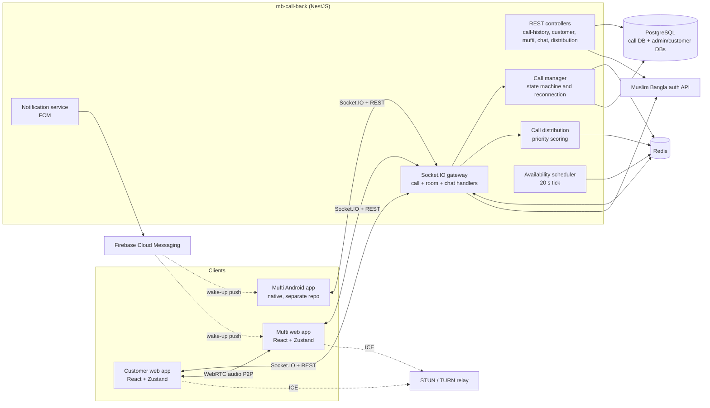
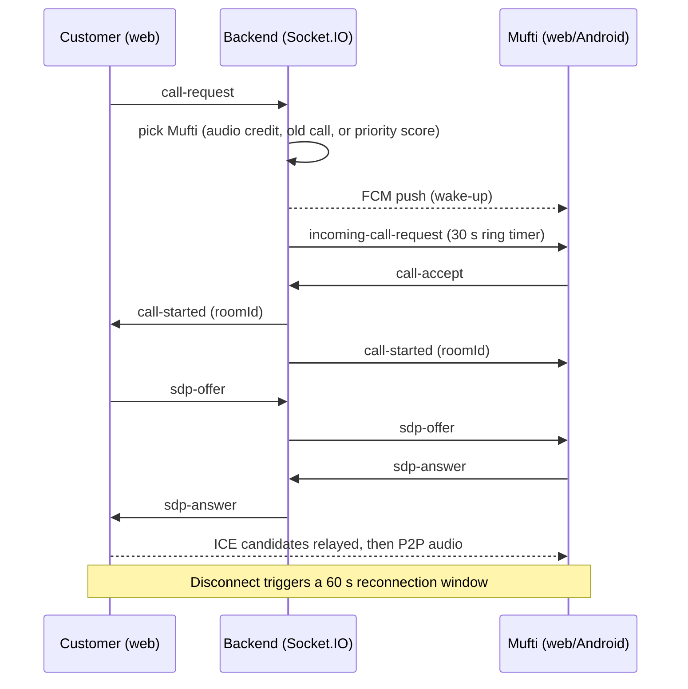

# Case Study: Muslim Bangla Call

## Overview

Muslim Bangla Call is a live voice-calling service inside the Muslim Bangla ecosystem. It lets a signed-in user speak directly with a Mufti (Islamic scholar) about a religious question (*masala*) over a browser-based WebRTC audio call. It consists of a NestJS signalling and REST backend (`mb-call-back`) and a React single-page client (`mb-call-react-front`). A native Android receiver app for Muftis, maintained in a separate repository, speaks the same protocol.

> Scope note: everything below is derived from the two repositories' source and design docs. Items that need the owner's input are marked `TODO:`.

## Background & Problem

Muslim Bangla's users need a way to reach a qualified scholar in real time instead of waiting for written answers. Running such a helpline raises problems that ordinary calling apps do not have:

- **Staffing is human and limited.** A small pool of Muftis answers calls, so the system must route each call to someone who is online *and* willing to take calls right now, and must not overload the same person.
- **Muftis have working hours.** A simple online/offline switch is not enough. They need schedules, and the schedule has to be evaluated in Bangladesh time regardless of where a Mufti's phone is.
- **Calls are paid or credited.** Access is governed by donation or payment credit, or by an "audio credit" granted after a Mufti answers a question. The call flow has to check, reserve and settle these.
- **Muftis are mostly on mobile.** A Mufti's phone may be locked or the app closed, so the system needs push-based wake-ups, not only open sockets.
- **Mobile networks are unreliable.** Calls drop. The service must recover a call without making both sides start over.
- **Two clients must stay consistent.** The web and Android clients implement the same receiver behaviour, and drift between them causes silent failures.

## Goals

Derived from the code and design documents:

1. Connect a customer to an available Mufti with one tap, with fair distribution across Muftis.
2. Keep the media path peer-to-peer; the server only does signalling and state.
3. Survive network drops with a bounded reconnection window instead of ending the call.
4. Give Muftis control over when they receive calls (master switch and a weekly Bangladesh-time schedule).
5. Support continuity of care: customers can be routed to a specific Mufti (follow-up calls, hand-overs between Muftis).
6. Keep web, backend and Android in agreement through explicit, written contracts.
7. Record every call (outcome, duration, reconnection attempts, quality metadata) so Muftis can review and settle calls.

## Solution

**Calling.** Customers and Muftis connect to a single Socket.IO gateway authenticated with the platform's bearer token. A call request creates a call ID, picks a recipient, rings them (socket event plus FCM push), and on acceptance puts both parties in a room. The browsers then exchange SDP offers/answers and ICE candidates through the gateway and open a direct audio connection. The caller always creates the offer; the receiver always answers.

**Routing.** A priority-scoring distribution service ranks the online, available Muftis (fewest completed unique customers today first, with a penalty for Muftis who already rejected this customer today) and picks randomly among the best. Rejected or unanswered calls rotate to the next Mufti. A Mufti-specific route is used for follow-up ("old") calls and for audio credits that are locked to one Mufti. If nobody is online, available Muftis get an FCM push and the caller is held in a waiting state for up to 30 seconds.

**Availability.** A Mufti has a master switch and a weekly schedule of slots in Bangladesh time. A pure, unit-tested module resolves the "effective" availability. A background scheduler re-evaluates it every 20 seconds, guarded by a Redis lock so multiple backend instances do not duplicate work, and updates Redis so that routing needs no schedule awareness.

**Hand-over.** A Mufti can assign a customer to another Mufti from the call-history list. The backend settles the finished call and grants a fresh audio credit routed only to the chosen Mufti. The customer is notified live (socket event and FCM).

**Web client.** A Zustand-based client manages the call state machine (idle, calling, incoming, connecting, reconnecting, in-call, ending), media permissions, speaker/earpiece switching, poor-connection recovery, and Mufti-side tools (availability toggle, schedule editor, call history, assignment).

## Users & Roles

| Role | Who | What they do |
|---|---|---|
| **Customer** (caller) | Signed-in Muslim Bangla user, typically with credit or an audio credit | Taps to call; may choose from the list of online Muftis; sees queue and waiting messages; reviews the status of the last call |
| **Mufti / admin** (receiver) | User with the "Masala Call Receiver" role (`is_admin: "true"`) in the admin system | Toggles availability, sets a weekly schedule, receives and answers calls, marks calls completed or awaiting, assigns a customer to another Mufti |
| **Platform / admin system** | Existing Muslim Bangla services | Issue the bearer token, own balances and roles, grant audio credits (the call backend validates tokens against it and calls it to charge credit) |
| **Android receiver app** | Separate native client for Muftis | Receives calls through a foreground socket service plus FCM wake-ups; shares the same contract as the web client |

## System Architecture

The call backend is a single NestJS application that hosts the REST API and the Socket.IO gateway. Redis holds live state (presence, pending/active calls, distribution counters) and, via the Socket.IO Redis adapter, lets several instances share the same rooms. PostgreSQL holds persistent records. Browsers connect directly for audio; STUN/TURN is used for NAT traversal.

Simplified call flow (details in [architecture.md](./architecture.md)):

## Key Technical Challenges & Decisions

**1. WebRTC with server-side signalling only.** The server relays SDP offers/answers and ICE candidates through Socket.IO rooms; media never touches it. A fixed role split (customer is always the offerer, Mufti always the answerer) removes glare and simplifies both the web and Android clients. The ICE list combines STUN with TURN over UDP and TCP, including port 443, to survive restrictive networks.

**2. A call lifecycle that survives bad networks.** Calls have a defined state machine (`pending`, `active`, `reconnecting`, `completed`, `cancelled`, `missed`). On disconnect of one party, the backend moves the call to a reconnecting state, notifies the peer, and starts a 60-second timer. On reconnect it restores socket IDs, emits an "advanced reconnection" context (was in call, needs WebRTC reset, who should re-handshake, duration, attempts), and asks the room to renegotiate. If the timer expires the call is ended with a `reconnection_timeout` reason. The web client adds ICE-restart offers and a poor-connection monitor that triggers recovery after a few seconds of degraded connectivity.

**3. Fair, explainable call distribution.** Distribution is a small scoring algorithm kept in Redis with 24-hour keys: unique customers served today plus a rejection penalty, lowest score first, random tie-break. The service exposes admin REST endpoints to inspect and tune it (config, scenario presets, simulate, compare, score), which makes the behaviour testable without live traffic.

**4. Availability scheduling in a single timezone.** Schedules are stored as JSONB (`sun..sat`, slots `HH:mm`) and always evaluated in Asia/Dhaka (UTC+6, no DST), independent of the device timezone. Rules: the master switch overrides everything; with the switch on, a day with enabled slots is available only inside them, while a day with none is available all day. Validation (format, ordering, no overlap, max 10 slots/day, no midnight crossing) is whole-document and returns structured error codes. The web client mirrors the module, with a comment that the two must be kept in sync. A scheduler flips Redis state on slot boundaries and notifies waiting customers when a Mufti comes online.

**5. Multiple backend instances.** The Socket.IO Redis adapter, a Redis lock for the scheduler tick, and Redis-based call state avoid single-instance assumptions. If Redis is unavailable at start, the gateway retries and then falls back to single-instance mode.

**6. Push notifications for a human helpline.** FCM v1 is used for incoming-call wake-ups, "Mufti is now online" notices to waiting customers, "Mufti assigned" notices, and missed-call alerts to other Muftis. The Android flow depends on this to ring when the app is closed.

**7. Web and Android parity.** Rather than leave drift to chance, the frontend repo carries five long-form docs: the Android receiver flow (about 1,300 lines), a point-by-point backend/web/Android contract comparison, the availability contract, the Mufti-assignment contract, and a short list of required native changes. A comparison pass found no breaking Android changes and traced one "Mufti app stopped ringing" report to a web customer-side dead-end instead.

**8. Credits and settlement.** The backend derives a credit type from the platform's customer profile (admins need none; payment and donation credits need a minimum balance and, for donations, an unexpired date) and prefers an unused audio credit. Completion marks the credit used or charges the external service. Mufti-to-Mufti assignment settles the old call and grants a new Mufti-locked credit in one operation, returning distinct HTTP errors (403, 404, 409 for double submit, 502 when charging fails and nothing was changed).

**9. Operational pragmatics.** Structured Winston logging with daily rotation, a global exception filter, global validation (whitelist plus forbid unknown fields), a periodic status health check that repairs stale presence keys, and hand-written SQL migration scripts in `docs/migrations/` for production (entity auto-sync is only enabled in development).

## Outcome & Impact

- Delivered a working end-to-end calling flow: browser-to-browser audio, Android receiver support, routing, scheduling, hand-over and call history.
- Documented the integration contracts in a form a native developer can implement against.
- TODO: add real metrics (calls per day/month, active Muftis, average call duration, answer rate, user satisfaction, uptime). Do not publish numbers that cannot be verified.
- TODO: add a short testimonial or stakeholder feedback if available.

## What I Learned

Drawn from what the code and docs show; edit to match your own experience.

- Signalling-only WebRTC is simple on paper; the hard part is the lifecycle around it (ringing timeouts, stale-call cleanup, reconnection windows, and idempotent endings).
- Keeping routing independent of scheduling (the scheduler writes effective availability into Redis; routing just reads it) kept a complex feature from touching the hot path.
- A pure, unit-tested availability module that both backend and frontend mirror makes timezone-sensitive logic reviewable.
- For multi-client systems, written contracts and cross-checked comparison docs are a cheap way to catch drift.
- Idempotent, all-or-nothing endpoints (whole-document schedule save, assignment that fails safe on charging errors) make flaky mobile networks much less risky.
- TODO: add your own lessons.

## My Role & Contributions

> TODO: Owner to fill in. Delete anything that does not apply. See [key-features.md](./key-features.md) for the feature list to pick from.

- [ ] Role / title on this project: `TODO`
- [ ] Team size and who I worked with: `TODO`
- [ ] Duration / dates: `TODO`
- [ ] Frontend (React client)
  - [ ] Call UI and state management (Zustand stores)
  - [ ] WebRTC client logic, reconnection and poor-connection recovery
  - [ ] Mufti dashboard (availability toggle, schedule editor, call history, assignment)
- [ ] Backend (NestJS)
  - [ ] Socket.IO gateway and call handlers
  - [ ] Call state machine and reconnection
  - [ ] Call distribution / priority scoring
  - [ ] Availability scheduling
  - [ ] Audio credits and Mufti assignment
  - [ ] FCM notifications
  - [ ] Database design and migrations
- [ ] Android integration (contracts, docs, parity review)
- [ ] Infra / deployment (PM2, environment configuration)
- [ ] Testing / QA
- [ ] Documentation
- [ ] What I would highlight in an interview: `TODO`
