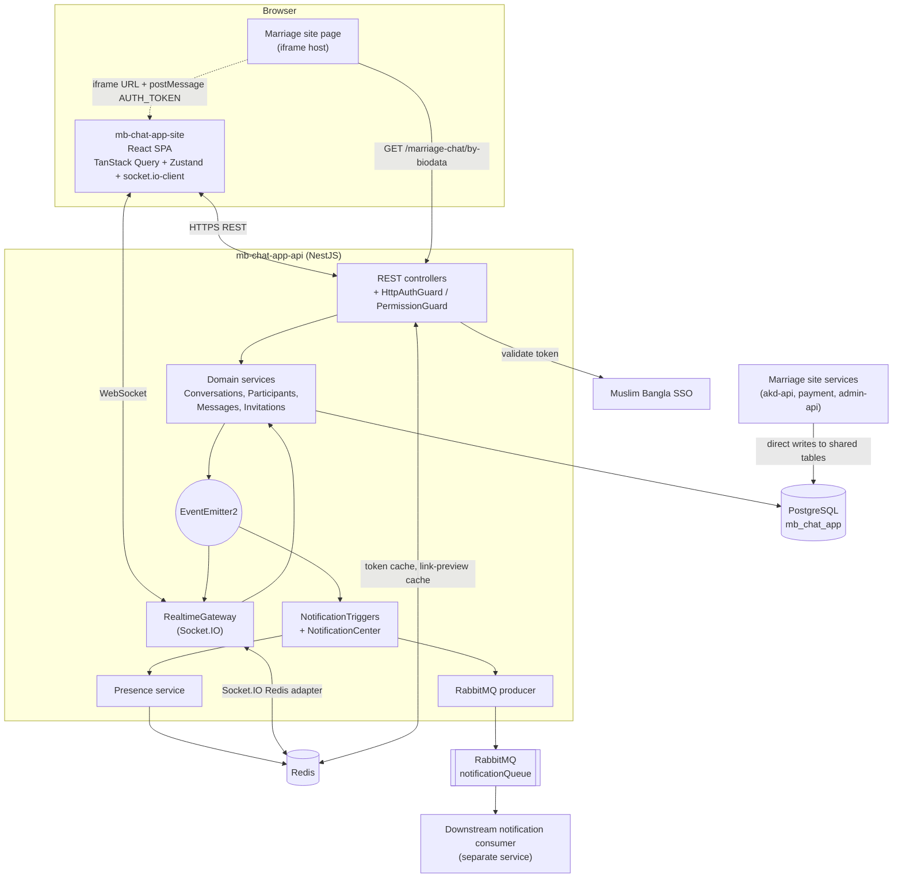

# Architecture

Muslim Bangla Chat is split into two repositories: a React SPA and a NestJS API. The API depends on PostgreSQL, Redis, RabbitMQ and the external Muslim Bangla SSO. Neither repo contains deployment configuration (no Dockerfile, CI file or hosting config was found), so the Deployment section below describes only what the code and docs state.



---

## Repository 1: `mb-chat-app-site` (frontend)

**Purpose.** The browser client: conversation list, message thread, composer, per-conversation settings and member management, invitation join flow, admin screens (roles, users), personal preferences. It also runs inside an iframe on the marriage site.

**Stack.** React 19, TypeScript, Vite 8 (dev server on port 5555), React Router 7, TanStack Query 5 (server state), Zustand 5 (messages, typing, UI preferences), Tailwind CSS 4, Radix UI, TipTap, socket.io-client, axios, Sonner, oxlint. Path alias `@` maps to `src`.

**Folder structure (trimmed).**

```
src/
  App.tsx, main.tsx          # router + providers (Query, ConfirmDialog, ContextMenu, Toaster)
  routes/
    auth-gate.tsx            # token capture (?token=, postMessage), CHAT_READY signal
    app-shell.tsx            # layout: sidebar + outlet
    sign-in-page.tsx         # "log in via main site" page (+ dev shortcuts)
    conversations/           # list, detail, settings, join-by-invite, new-conversation modal
    roles/                   # role management + add/edit modal
    admin/                   # admin users page, roles/permissions modals
    profile/, settings/      # my permissions, appearance preferences
  components/
    chat/                    # message-list, bubble, composer, side panel (info/members/settings tabs),
                             # attachments, link preview, typing indicator, marriage rules dialog
    conversations/           # sidebar, list item, hamburger menu
    permission/              # permission gate, picker, grant grid
    common/, table/          # Radix-based UI kit, reusable data table
  providers/socket-provider.tsx   # single owner of the socket + all listeners
  stores/                    # messages-store, typing-store, ui-preferences-store (Zustand)
  services/                  # axios API wrappers per domain
  hooks/                     # current user, permissions, link preview, redirect-on-forbidden
  constants/, types/, lib/   # mirrored constants, typings, token storage, formatting
```

**Main modules.**
- *Socket provider.* A single provider owns the socket connection and all listeners. Components call helper functions (`sendMessage`, `startTyping`, `markMessageRead`) and read state from TanStack Query invalidation, the typing store and the messages store.
- *Messages store.* Holds per-conversation message lists with optimistic entries, handles prepending older history, upserting by id or client message id, failure state and soft deletion.
- *Permission layer.* Effective permissions come from `/auth/me`. `PermissionGate` and hooks gate UI actions; the backend independently authorizes every request.
- *Conversation detail page.* Loads history with cursor paging, joins the socket room, auto-marks read, computes read ticks from other participants' read cursors, and handles embedded mode (`hideHeader`, `showInstruction`).

**Realtime approach.** `socket.io-client` with the websocket transport, infinite reconnection (2 to 10 second backoff), token passed in the handshake `auth`. Inbound events update the messages store directly (message created/updated/deleted), patch cached read cursors in place, or invalidate conversation queries (membership and settings changes, `SYNC_REQUIRED`). Sends use an 8-second ack timeout with optimistic UI.

**Auth approach.** No login UI of its own. The token arrives via `?token=` redirect from the main site, via a `postMessage` from an embedding page, or from a shared cookie. It is kept in memory plus a cookie and sent as a bearer header by an axios interceptor; a 401 clears it. `GET /auth/me` is the real gate (`AuthGate`).

**Deployment.** Standard Vite build (`tsc -b && vite build`) producing a static `dist/`. API origin comes from the `VITE_API_URL` build-time variable. Hosting and framing headers are set outside the repos; the API docs state the host must allow framing by the marriage site only (`frame-ancestors`).

**Third-party integrations.** Muslim Bangla SSO (via the shared token), the marriage site (iframe embedding, message handshake).

---

## Repository 2: `mb-chat-app-api` (backend)

**Purpose.** The system of record and realtime hub: authentication against the SSO, conversations and participants, messages and rules, invitations, uploads, link previews, roles and permissions, presence, offline notifications, and the marriage-chat availability API.

**Stack.** NestJS 11, TypeScript, TypeORM 1.x on PostgreSQL, Socket.IO 4 with `@socket.io/redis-adapter`, ioredis, amqplib, class-validator, Winston, Jest, ESLint and Prettier.

**Folder structure (trimmed).**

```
src/
  main.ts, app.module.ts     # bootstrap: validation pipe, Bengali exception filter, CORS, Redis IO adapter
  config/configuration.ts    # typed config from environment variables
  auth/                      # SSO token validation, guards (HTTP + WS), current-user decorator
  users/                     # user sync from SSO payload, search, lookup, admin user management
  roles/, permissions/       # role CRUD, permission guard/decorator/service
  conversations/             # service, controller, membership guard, settings subscriber, events, display utils
  participants/              # members, leave, self-mute, moderator mute, block; settings subscriber
  messages/                  # send/edit/delete/list/read/unread, validation service, events
  invitations/               # invite links: create, list, revoke, preview, accept
  uploads/                   # conversation-image and message-attachment endpoints
  link-preview/              # server-side OG/Twitter metadata fetch + cache
  realtime/                  # RealtimeGateway + RedisIoAdapter
  presence/                  # Redis-backed online status
  notification/              # triggers (domain events) + notification-center (payload + queue)
  rabbitmq/                  # resilient producer-only client
  marriage-chat/             # biodata link entity, availability endpoint, service (+ spec)
  common/                    # redis module, logger, Bengali exception filter, settings diff util, naming strategy
  constants/                 # conversation types/defaults, permissions, roles, socket events, limits
  migrations/                # 16 TypeORM migrations
scripts/                     # seed-roles.ts, assign-admin.ts
docs/marriage-chat-embed.md  # integration contract and deployment checklist
```

**Main modules.**

| Module | Responsibility |
|---|---|
| `auth` | Validates bearer tokens against the SSO (`get-user-info-checking-role`), caches in Redis, syncs the local user, blocks flagged accounts |
| `conversations` | Create private/group chats, list with pagination, update settings/info/status; transactional status changes that also complete marriage links |
| `participants` | Add/remove/leave, self-service mute durations, moderator mute and block |
| `messages` | Single send pipeline with all rule checks; edit/delete; cursor-paginated history; read/unread cursors |
| `invitations` | Tokenised invite links with optional expiry and max uses |
| `permissions` / `roles` | Fixed permission catalogue, dynamic roles, guards, oversight checks per conversation type |
| `realtime` | Socket.IO gateway, rooms, typing relay, domain-event-to-socket translation |
| `notification` | Offline-only push payloads published to RabbitMQ |
| `marriage-chat` | `GET /marriage-chat/by-biodata/:id` plus the biodata link entity |

**Data model highlights (PostgreSQL via TypeORM).**
- `users`: unique customer id and email, `UserType` (`CUSTOMER`/`ADMIN`), blocked flag, JSONB `info` (including marriage biodata id), many-to-many to `roles`.
- `roles`: slug, name, description, JSONB list of permissions, system-role flag. Permissions themselves are code constants, not rows.
- `conversations`: integer id plus unique external UUID, `type` enum, `status` (`ACTIVE`/`ARCHIVED`/`BLOCKED`), name/description/image, JSONB `settings` (stored sparsely), last-message timestamp and preview, blocked-at and blocked-reason fields, creator.
- `conversation_participants`: unique per (conversation, user), JSONB participant settings, `lastReadAt` cursor, self-mute and moderator-mute fields, `leftAt`.
- `messages`: UUID id, indexed on (conversation, created time), type, text content, attachment type/url/name/size, `clientMessageId`, self-referencing reply, edited and deleted timestamps.
- `invitations`: unique token, creator, expiry, max uses, use count.
- `marriage_biodata_links`: conversation, `running`/`completed` status, connection id, sender and receiver customer and biodata ids; partial unique index so only one running link exists per connection.
- Naming: snake-case strategy; schema evolves only through migrations (`synchronize: false`).

**Realtime approach.**
- `RealtimeGateway` authenticates in `handleConnection`, joins the user room `user:<id>` and every active `conversation:<id>` room, marks presence, and emits `chat:connection:ready`.
- Client-to-server events: join/leave conversation, send message (ack returns the message or an error object), typing start/stop, mark read.
- Server-to-client events are produced by `@OnEvent` handlers reacting to domain events: message created/updated/deleted/read, member added/removed/left, conversation settings updated, plus `sync required`.
- Event names are centralised in a constants file mirrored by the frontend.
- `RedisIoAdapter` (pub/sub clients) enables multi-instance operation. Presence is a Redis key `user:<id>:online` with a 300-second TTL.
- Oversight users can join conversation rooms for types they may view, even without being participants.

**Auth approach.**
- External SSO is the identity authority. Bearer token (header, or `?token=` fallback) is validated through the identity service, cached in Redis (default 24 hours), and mapped to a local user row.
- Authorization is permission-based: baseline participant permissions, global roles (Moderator, Super Admin, custom), a Super Admin bypass, and per-type oversight permissions. Conversation access additionally goes through a membership guard.

**Deployment.**
- Configuration is environment-driven (`NODE_ENV`, `PORT`, database, Redis, SSO base URL and cache TTL, frontend URL, comma-separated CORS origins, marriage site URL; RabbitMQ settings are read from `AMQP_*` variables). Values are not reproduced here.
- Scripts: `npm run build`, `start:prod` (`node dist/main`), migration scripts (`mg`, `mr`, `migration:revert`), `seed:roles`, `seed:admin`.
- Uploads are written to a local `uploads/` directory and served statically, so multi-instance deployments would need shared storage (the code calls this a placeholder for cloud storage).
- `docs/marriage-chat-embed.md` contains the deployment checklist for the embedded chat: CORS origins, frontend and marriage-site URLs, database permissions for the other services, and framing headers (`frame-ancestors`).
- No Dockerfile, CI pipeline or infrastructure-as-code exists in the repo; `.env.example` mentions a docker-compose file that is not present.

**Third-party integrations.**
- *Muslim Bangla SSO / identity service:* token validation and customer lookup by email.
- *RabbitMQ:* publishes to the shared `notificationQueue` consumed by a separate service that handles push (FCM), socket, email and persistence channels.
- *Muslim Bangla marriage site and services (`mb-akd`, `mb-akd-api`, `mb-payment`, `mb-admin-api`):* open and close marriage chats by writing this service's tables directly; the marriage site's browser calls the availability endpoint; notification links deep-link back to the marriage site.
- *External websites:* fetched server-side for link previews.

---

## Cross-cutting notes

- **Domain events as the integration seam.** Domain services emit events; the gateway (sockets) and notification triggers (queue) subscribe. Adding a new delivery channel requires no change to business services.
- **Rules live in settings.** New conversation behaviour is a new setting plus a validation check in one service, not a new code path per type.
- **Shared contract with other services.** The marriage-chat tables are written by other repos; any schema change there must be coordinated with them (the API docs say so explicitly).
- **Localization.** Server errors and notification texts are Bengali; the frontend UI mixes English labels with Bengali content for the marriage chat rules and sign-in guidance.
