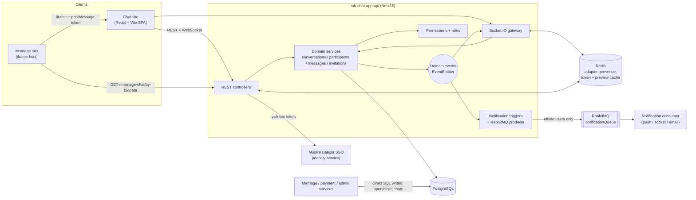

# Muslim Bangla Chat: Case Study

## Overview

Muslim Bangla Chat is a realtime messaging platform for the Muslim Bangla product family. It consists of a React single-page app (`mb-chat-app-site`) and a NestJS API (`mb-chat-app-api`) with PostgreSQL, Redis, Socket.IO and RabbitMQ behind it. It supports one-to-one and group conversations with attachments, replies, edits, typing indicators and read receipts, and adds a role and permission system for moderators and administrators.

Its most distinctive use is the **marriage private chat**: a tightly rule-limited, anonymous two-person conversation that opens when two people connect through a biodata request on the Muslim Bangla marriage site, and that can be embedded in that site as a floating iframe widget.

## Background & Problem

The Muslim Bangla ecosystem consists of several separate products, including a main site with a shared login, a marriage site with biodata and connection requests, payment and admin services, and a customer-support backend. These products needed a messaging capability, but with requirements that general-purpose chat tools do not cover:

- Users already have identities in the shared Muslim Bangla SSO, and a new chat product should not require another account.
- On the marriage site, two people who are exploring a match need a controlled way to talk before exchanging contact details. The conversation should be anonymous, short, and hard to abuse (no phone numbers, emails or links, no unlimited messaging).
- A conversation tied to a paid or accepted connection must start and end in step with that connection's lifecycle, and the marriage site must be able to show the chat inside its own pages.
- Staff need to oversee and, where necessary, shut down conversations, with fine-grained control over who can do what.

Note: the business context above is inferred from the code and the project's own `docs/marriage-chat-embed.md`. TODO: confirm and add owner's own framing of the original business problem.

## Goals

Derived from what the code implements:

1. Provide realtime, reliable chat (1:1 and group) that works across multiple server instances.
2. Reuse the existing Muslim Bangla SSO instead of building a new identity system.
3. Keep the chat engine generic, so a new conversation type is "just a new set of default settings", not a new engine.
4. Support an anonymous, limited-message marriage chat with automatic closure, and let it be embedded in another site.
5. Give staff fine-grained moderation and administration (roles, permissions, platform-wide oversight by conversation type).
6. Notify offline users without building a notification stack from scratch, by publishing to the shared notification queue.

## Solution

**Generic conversation engine driven by settings.** Every conversation has a type and a settings object (message max length, allow reply/edit/delete, allowed attachment types, phone/email/link sharing, max consecutive messages, max messages per participant, and more). The type only supplies the defaults, so `MARRIAGE_PRIVATE` is expressed as data: a 50-character limit, no attachments, no contact sharing, strictly alternating sends, and a lifetime quota of three messages each. Message sending funnels through one service that enforces all of these rules server-side, regardless of whether the message arrives over REST or a socket.

**Realtime delivery over Socket.IO with Redis.** Clients authenticate once per connection, join per-user and per-conversation rooms, and receive events for new, edited and deleted messages, typing, read cursors, membership changes and settings changes. A Redis adapter lets events cross server instances, and Redis also tracks presence.

**SSO-based auth.** The API validates the bearer token against the external Muslim Bangla identity service, caches the result in Redis, and syncs a local user row. The site captures the token from a redirect query parameter, or, when embedded in an iframe, from a `postMessage` handshake with the host page.

**Permissions and moderation.** Permissions are fixed in code; roles are database rows that bundle permissions. Ordinary participants get a baseline set automatically. Moderator and Super Admin roles unlock settings changes, status changes, muting, blocking, editing or deleting others' messages, and platform-wide oversight per conversation type.

**Marriage-site integration.** The marriage site's own services open and close chats by writing the chat database directly (a documented shared-table contract), and the marriage site's browser asks the chat API whether a chat is available for a given biodata. A completed chat is final: a new connection or an admin re-enable creates a brand new conversation.

**Offline notifications.** New-message, member-added and member-removed events are turned into notification payloads and published to a RabbitMQ queue, but only for users with no live socket connection (presence in Redis). Marriage-chat notifications use anonymous "Biodata N" labels and link back into the marriage site.

## Users & Roles

| Role | Description | Source |
|---|---|---|
| **Customer** | An ordinary Muslim Bangla user. Gets baseline chat permissions automatically in any conversation they participate in: send messages and attachments, edit/delete own messages, view participants and old messages, leave. | `UserType.CUSTOMER`, `BASELINE_PARTICIPANT_PERMISSIONS` |
| **Marriage-chat participant** | A customer in a `MARRIAGE_PRIVATE` conversation. Anonymous (shown by biodata label), message-limited, no attachments or contact sharing. | `ConversationType.MARRIAGE_PRIVATE` |
| **Moderator** | Seeded system role. Can hold moderation and oversight permissions (mute/block participants, change settings and status, view or manage any conversation of a type without joining it). | `SystemRoleSlug.MODERATOR` |
| **Super Admin** | Seeded system role. Bypasses every permission check. Bootstrapped by a script that assigns the role to an existing user by email. | `SystemRoleSlug.SUPER_ADMIN` |
| **Admin (user type)** | Internal staff flag that influences which UI a user sees; real authorization is still permission-based. | `UserType.ADMIN` |
| **Custom roles** | Admin-defined roles with any combination of the fixed permissions. | `roles` table, role management UI |

## System Architecture

The frontend is a single-page app that talks to the API over REST (axios) and a persistent Socket.IO connection. The API is a modular NestJS monolith. Domain services (conversations, participants, messages, invitations) emit domain events through an in-process event emitter; the realtime gateway and the notification triggers both subscribe to those events, so persistence logic never depends on transport or notification code. PostgreSQL is the system of record; Redis serves the Socket.IO adapter, auth-token cache, presence and link-preview cache; RabbitMQ carries notifications to a separate downstream consumer. Other Muslim Bangla services interact with the chat database directly for marriage chats.

## Key Technical Challenges & Decisions

**1. One send pipeline for REST and WebSocket, with ack-based errors.**
Both transports call the same `MessagesService.send`, which checks conversation status, participant block/mute state, permission, settings, attachment rules, consecutive-message limits, quotas, length and contact-info rules before saving. In the gateway, thrown exceptions would never reach the sender's acknowledgement callback (Nest routes them to a global event and the pending ack is dropped), so HTTP exceptions are caught and returned as an error ack instead. On the client, the sender sees an optimistic message that is reconciled using a `clientMessageId`, can be retried on failure, and times out after 8 seconds.

**2. Making rules data, not code branches.**
Conversation behaviour is defined by a settings object with per-type defaults. Settings are stored sparsely: TypeORM entity subscribers compress them to only the fields that differ from the type's defaults on write and expand them to a full object on load, so every consumer sees complete settings while storage stays small and default changes propagate. The same approach applies to per-participant settings. The code comments explicitly keep the engine generic so a future channel type would need no new engine.

**3. Read state as a per-participant cursor.**
Instead of storing a read flag per message, each participant has a `lastReadAt` cursor. Sending a message bumps the sender's own cursor, marking read updates the cursor and broadcasts a read event, and the UI computes ticks from the latest cursor among the other active participants. The client patches cached conversation queries in place rather than refetching. There is also a manual "mark as unread" action.

**4. Realtime across instances.**
A custom `RedisIoAdapter` is wired before `listen()` so events emitted on one API instance reach sockets connected to another. Room membership is managed via per-user rooms so that joining or leaving a conversation can be applied to all of a user's sockets, and a `SYNC_REQUIRED` event tells clients to refetch when membership changes. The code notes that room join/leave calls are fire-and-forget even with the adapter.

**5. Presence-aware notifications through a shared queue.**
Presence is a Redis key with a 5-minute TTL, refreshed on every inbound socket event and removed on disconnect. Notifications are only enqueued for recipients without an active socket, and muted participants are excluded. The RabbitMQ producer uses a confirm channel, persistent messages and durable queues, plus reconnect and retry-once logic so a dropped broker connection does not permanently break sends. The service mirrors the structure of another Muslim Bangla backend so the same downstream consumer can be reused.

**6. Marriage chat lifecycle across services.**
The marriage chat has hard product rules: strictly alternating messages, three messages per person, 50 characters, no contact info, no attachments, and editing only while a message is still the latest. When both participants exhaust their quota the conversation auto-blocks. A single code path (`ConversationsService.updateStatus`) completes the linked `marriage_biodata_links` row in the same transaction as any block, so a "running" link always means a usable chat and a completed chat is never reopened. A partial unique index on running links per connection prevents two live chats for one connection. Other services write these tables directly, so the table layout is documented as a shared contract.

**7. Embedding in an iframe and signing in across origins.**
Cross-origin iframes cannot read the parent's cookies, and third-party cookie blocking can silently drop cookie writes. The site keeps the token in memory as well as in a cookie, signals `CHAT_READY` to the host, and accepts an `AUTH_TOKEN` `postMessage`. Embedded mode (`hideHeader=true`) hides the header and shows the rules dialog once per conversation, remembered in local storage. The API docs also describe the framing-header and CORS requirements for safe embedding.

**8. Anonymity as a cross-cutting concern.**
For marriage chats the display name, typing indicator and the offline push all use anonymous "Biodata N" labels (Bengali digits in the push), never real names or emails. This had to be enforced in several places rather than one.

**9. Attachments and link previews.**
Uploads use Multer to local disk with randomised file names, MIME allow-lists and size limits (5 MB for conversation images, 25 MB for message attachments). A link-preview endpoint fetches Open Graph / Twitter / title metadata server-side, blocks private hosts, and caches results in Redis for seven days. The upload code notes that the local-disk storage is a placeholder that can be swapped for cloud storage without changing the frontend contract.

**10. Permission model.**
Permissions are constants in code (they are not database rows); only their assignment to roles is dynamic. There is no per-conversation role: every active participant gets a baseline set, and everything moderation-related requires a global role. Oversight permissions are per conversation type, so a moderator can view or manage all marriage chats without being a participant. The UI mirrors this with permission gates, while the backend authorizes every request independently.

**11. Bengali-first user experience.**
A global validation pipe and exception filter turn framework errors into single Bengali sentences while keeping per-field details in the response, and most domain errors are authored in Bengali.

## Outcome & Impact

What the code demonstrates:

- A working multi-instance-capable chat backend with REST and WebSocket entry points, a migration history of about 16 migrations, and role-based administration.
- Integration with the marriage site (embedded chat, notification deep links, shared-table contract) and with the shared notification infrastructure.

Impact numbers are not available in the repositories. Fill in what you can verify:

- Active users / conversations / messages: TODO
- Marriage chats opened / completed: TODO
- Notification delivery or reply-rate improvement: TODO
- Production launch date and current status: TODO
- Client or business feedback: TODO

## What I Learned

Written from what the code shows; edit to match your own experience.

- Designing for a second and third use case early (settings-per-type instead of per-type code) pays off when product rules, like the marriage chat, are very different from a normal chat.
- Realtime features need explicit thought about failure paths: acknowledgement errors, optimistic UI reconciliation, reconnection, and cross-instance fan-out.
- Event-driven decoupling (domain events consumed by the gateway and the notification layer) keeps business services free of transport concerns.
- Embedding an app across origins surfaces auth, cookie, CORS and framing-header issues that do not appear in a standalone app.
- Sharing a database table between services is fast but turns the schema into a public contract that must be documented and migrated carefully.
- Localization is more than translated strings: error filters, notification text and number formatting (Bengali digits) all need handling.

TODO: add personal reflections, mistakes, and what you would do differently (for example, tests, cloud file storage, and server-side iframe origin checks).

## My Role & Contributions

> TODO: Fill this in. Delete anything that does not apply. Use first person.
> (Hint from git history: the large majority of commits in both repos are by the repo owner. Confirm what that covers.)

**My role:** TODO (for example: Full-stack developer / Backend lead / Sole developer)

**Team size and context:** TODO

**Timeframe:** TODO (git history suggests roughly Jan to Oct 2026 for the API and Aug to Oct 2026 for the site)

Checklist of areas I worked on (tick what applies):

- [ ] Overall architecture and technology choices
- [ ] Database schema and migrations
- [ ] Authentication / SSO integration and token handling
- [ ] Realtime messaging (Socket.IO gateway, Redis adapter, presence)
- [ ] Message pipeline and validation rules (settings, quotas, contact-info rules)
- [ ] Read receipts, typing indicators, optimistic sending
- [ ] Roles, permissions and moderation features
- [ ] Group chat, invitations and member management
- [ ] File and media uploads, link previews
- [ ] Offline notifications (RabbitMQ producer, triggers)
- [ ] Marriage private chat and marriage-site integration (iframe, postMessage auth)
- [ ] Frontend UI (conversation list, thread, composer, settings panels)
- [ ] Admin screens (users, roles, permission picker)
- [ ] Theming and personalization
- [ ] Bengali localization of errors and notifications
- [ ] Testing, linting, tooling
- [ ] Deployment / DevOps
- [ ] Documentation

Notable results I can point to: TODO
