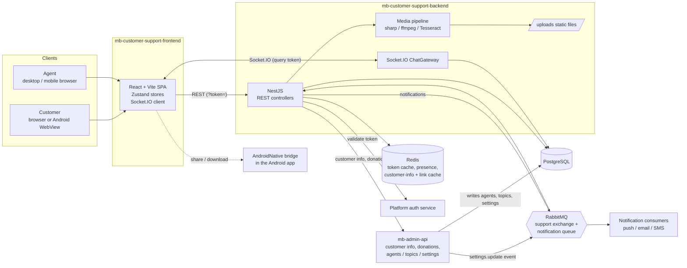

# Architecture

Two repositories make up the product: a React single-page app (customer chat and agent console in one bundle) and a NestJS API that serves REST, WebSockets and uploaded media. Both depend on shared Muslim Bangla platform services (auth, admin API, notification consumers), which live outside these repos.



## Repository 1: `mb-customer-support-frontend`

**Purpose.** The single user interface for both audiences. Customers get a full-screen chat; agents get an inbox, info panel, group chats and a settings area. The role comes from the authenticated user returned by `GET /auth/me`.

**Stack.** React 19, TypeScript (non-strict), Vite 5, Tailwind CSS v4 (Vite plugin, no config file), Zustand stores, Radix UI primitives, Tiptap, Socket.IO client, Axios.

**Folder structure (trimmed).**

```
src/
  api/          # Axios wrappers per backend area (conversations, groups, notes, tags,
                #   topics, settings, upload, users, outreach, linkPreview, phone, autoResponses)
  components/
    agent/      # AgentView, ConversationList, filter panel, dialogs, settings/ pages
    customer/   # CustomerView, topic prompts, phone prompt, site-unavailable screen
    common/     # ConversationChatWindow, ChatBubble, MediaGallery, ImageEditorDialog,
                #   RichTextEditor, info-panel sections, donation dialogs, group panels
    ui/         # local wrappers over Radix primitives
  hooks/        # useAuth, useSocket, useVoiceRecorder, useDragSelectMessages,
                #   useConversationMedia, useWebviewBackBuffer, ...
  lib/          # androidNative, download, share, rich-text, permissions, working-hours,
                #   currentUserCookie, message-filter, chat-wallpaper, color-themes, ...
  routes/       # AgentRoutes (owns the router), CustomerRoutes, CustomerRedirectPage
  store/        # auth, conversation, filters, drafts, theme, wallpaper, settings, topics, tags ...
  types/        # shared types, permissions, settings, groups
  utils/        # notify (sound + OS notification), parse-support-url
```

**Main modules.**

- `App` lazy-loads either `AgentRoutes` (which owns `BrowserRouter`) or `CustomerRoutes`, so customers never download the router.
- `useSocket` is the single subscriber to all server socket events and writes into the Zustand stores; components never subscribe directly.
- `ConversationChatWindow` (about 1,900 lines) is the shared chat surface for customer chats, agent views and groups (via an `isGroup` mode).
- Agent-only or on-demand pieces (info panel, gallery, image editor, settings pages, phone prompt) are `React.lazy`; `vite.config.ts` splits editor, Radix and React into their own chunks.

**Data and state highlights.** Server state lives in `conversationStore` (customer conversations, a separate list for groups, messages keyed by conversation, unread sets, typing state) with supporting stores for filters, drafts, themes, wallpapers, support settings and topics. Device-only preferences are persisted to `localStorage`.

**Auth approach.** Token from the shared `currentUser` cookie on the platform domain, or a `?token=` URL hand-off; validated with `GET /auth/me`. Axios appends the token as a query parameter and the socket passes it as a handshake query. A 401 clears state and shows a sign-in screen. Agent permissions arrive with the user and are updated live over the socket.

**Deployment.** Static build (`tsc && vite build`) to `dist/`. No Dockerfile, CI config or hosting config is committed; the API and socket URLs come from two Vite env variables (see `.env.example`). TODO: describe hosting and pipeline.

**Integrations.** Backend REST and Socket.IO; Android `AndroidNative` WebView bridge; browser Notification, Web Audio, MediaRecorder and canvas APIs; public invoice and admin-panel URLs used as links.

## Repository 2: `mb-customer-support-backend`

**Purpose.** REST and WebSocket API for conversations, groups, topics, notes, FAQ, tags and settings; also the media pipeline and the bridge to platform services (auth, admin API, notification queue).

**Stack.** NestJS 10, TypeORM 0.3 on PostgreSQL, ioredis, amqplib, Socket.IO, Multer, sharp, fluent-ffmpeg, tesseract.js, class-validator.

**Folder structure (trimmed).**

```
src/
  auth/            # HTTP + WS guards, roles + permissions guards, token validation
  users/           # User entity, permissions model, customer-info + donation proxy service
  conversations/   # Conversation, participants, messages, reads; service (core logic),
                   #   OCR service, payment text parser, Tesseract reader
  chat/            # ChatGateway (Socket.IO), Message type enum
  groups/          # Agent-to-agent groups: service, controller, permission rules
  topics/          # Topics, agent-topic assignment, mute, ordering
  notes/ auto-responses/ tags/   # Agent productivity entities
  settings/        # support_settings, in-memory cache, working-hours helpers
  outreach/        # Agent-initiated conversations, customer lookup
  send-message/    # Machine-to-machine "post a message for this customer" endpoint
  link-preview/    # Link preview fetch + Redis cache
  upload/          # Multer upload, size limits, media-processing util
  notification/    # Notification center (RabbitMQ queue, dedupe, offline-only sends)
  presence/ rabbitmq/ common/redis/
  migrations/      # 33 TypeORM migrations
docs/              # conversation-mode-plan.md (historical design plan)
webview-share-download-methods.md   # spec of the Android app's JS bridge
docker-compose.yml # local Postgres 15, Redis 7, RabbitMQ 3
```

**Main modules.** Conversations (core), Chat gateway, Groups, Topics, Users/customer-info, Settings, Notification, Upload, plus the small CRUD modules. `RedisModule`, `UsersModule`, `AuthModule`, `PresenceModule` and RabbitMQ are global.

**Data model highlights.**

| Entity | Notes |
|---|---|
| `users` | `customer_id` (unique, from the auth service), `role` (AGENT / CUSTOMER; SUPER_AGENT is a retired legacy enum value), `permissions` jsonb, cached `customer_info` jsonb |
| `conversations` | `kind` (CUSTOMER / GROUP), `status` (ACTIVE / BLOCKED), current topic, `last_message_at`, `initiated_by`, group name / description / avatar, `read_baseline_at`; unique per customer |
| `conversation_participants` | Agent membership with `left_at`, group `role`, `group_permissions` jsonb, `muted_until`, `last_read_at` |
| `conversation_messages` | Type (TEXT, IMAGE, VIDEO, AUDIO, FILE, SYSTEM), reply reference, reactions, forward info, edited and deleted timestamps, per-message topic, `read_at` |
| `conversation_reads` | Per (conversation, agent) read cursor and "marked unread" timestamp |
| `topics`, `agent_topics` | Slug, sort order; agent assignment with mute |
| `tags`, `notes`, `auto_responses` | Agent productivity data (auto responses: MESSAGE or QUESTION, DRAFT or PUBLISH, on-user-join trigger) |
| `support_settings` | Key plus jsonb value (`working_hours`, `bot_replies`, `chat_messaging`, `site_status`) |

The schema moved from a ticket model to the conversation model: a migration drops the ticket tables, so the backend's own `CLAUDE.md` section on tickets (and the frontend README's ticket mode) describes history rather than current behaviour.

**Real-time design.** One Socket.IO gateway with `user:<id>` rooms for personal notifications and `conversation:<id>` rooms for chat events. Group members are placed in the room on connect or when added. Presence is tracked in Redis and used to choose between live sockets and queued push.

**Auth approach.** Stateless: a guard extracts the token from query, header or the socket handshake; `AuthService` checks Redis (24 h) and otherwise calls the platform auth service; the user is upserted and attached to the request or socket. Roles and per-agent permissions are enforced in guards and services.

**Deployment.** `nest build` to `dist/`, run with `node dist/main`. Static media is served from the process's `uploads/` folder at `/uploads` (git-ignored). Migrations are run manually (`migration:run`). CORS is open (`origin: '*'`) with the stricter `FRONTEND_URL` option commented out in code. No Dockerfile or CI config is committed; Docker Compose is for local dependencies only. TODO: describe production hosting.

**Third-party and platform integrations.**

- Platform auth service (token validation).
- `mb-admin-api` for customer info, donations, receipts and SMS; it also writes agents, topics and settings directly into this database, so schema changes must be coordinated.
- RabbitMQ: durable `support` exchange (settings updates consumed here; support events published) and a notification queue consumed elsewhere.
- Tesseract.js with English and Bangla language data for OCR (runs locally, no external API).
- ffmpeg (bundled via installer packages) and sharp for media.
- The Android app's `AndroidNative` bridge (client-side).

## Cross-repo contracts

- Permission and settings types are mirrored by hand across the support backend, the support frontend, `mb-admin-api` and `mb-admin-front`; the repos' docs state that changes must be made in all four places.
- Cursor pagination, message visibility and unread logic are computed on the server; the client only keeps live updates consistent.
