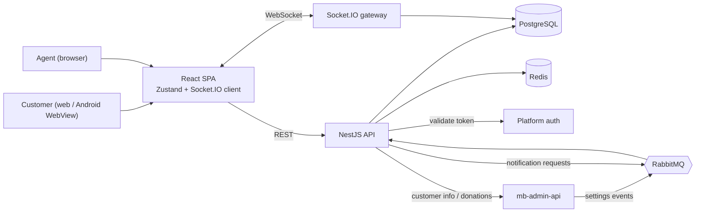

# Case Study: Muslim Bangla Customer Support App

## Overview

Muslim Bangla Customer Support is a real-time support chat and agent console for the Muslim Bangla platform. Customers talk to support from the website or from inside the Muslim Bangla Android app's WebView; support agents work from a web console with a live inbox, canned content, customer data from the wider platform, and agent-only group chats. It is delivered as two repositories: a React + Vite frontend and a NestJS backend (PostgreSQL, Redis, RabbitMQ, Socket.IO).

From the git history, both repositories were started on the same day in April 2026 and were still receiving commits in November 2026 (roughly 240 frontend and 167 backend commits). TODO: confirm the project timeline and team size.

## Background & Problem

The Muslim Bangla platform spans several services: marriage biodata, jobs, donations, products, zakat, masala (religious Q&A) and a blood-donation site. Each generates different kinds of support questions, and the people answering them need to see who the customer is and what they have done on the platform. Customers can arrive from the website or from the Muslim Bangla Android app's WebView (TODO: add the share of mobile traffic if known).

The code and docs point to these problems the app addresses (TODO: confirm and rephrase in the owner's words):

- Support questions arrive on very different topics and need to reach the right agents.
- Agents need customer context (orders, payments, donations, marriage and job profiles) without switching to the admin panel.
- Donations are often reported with a screenshot of a mobile-banking receipt; matching them to records is manual and error-prone.
- Operations staff need to control behaviour (working hours, auto-replies, who can do what) without a deployment.
- The customer experience lives inside a native Android WebView with its own constraints: no Web Share API, no `<a download>`, a back button that can exit the page, microphone permissions owned by the host app.

## Goals

- Give customers a low-friction way to reach support: open the chat and write.
- Route conversations by topic to the agents responsible for them.
- Give agents one workspace for chatting, customer context and routine donation bookkeeping.
- Make behaviour admin-configurable and live: working hours, bot replies, messaging rules, per-agent permissions.
- Work well on phones and inside the Android WebView.
- Integrate with the existing platform login and admin API rather than creating parallel systems.

## Solution

The first version used a ticket lifecycle (customer submits a form, waits, an agent joins, the ticket closes). The repos show this was later replaced: a migration drops the ticket tables, and the product now centres on **one persistent conversation per customer**, tagged with a **topic** that controls which agents see it. This removed the form and waiting screen and gave customers continuity across visits. Note that the frontend README still describes the old ticket mode, so it should not be used as the source of truth.

Key elements of the delivered solution:

- **Chat.** Real-time messaging with rich text, replies, edits, deletes, reactions, forwarding, voice notes, images (with a built-in editor), video, files, link previews and a media gallery.
- **Agent console.** Topic-scoped inbox, join/leave, per-agent unread state, filters, tags, canned notes (slash picker), FAQ answers, block, assign agents, proactive outreach and deep links from the admin panel.
- **Customer context.** An info panel backed by the platform admin API, plus offline-donation entry with screenshot OCR and receipt sending.
- **Operations control.** Working hours, bot replies, messaging rules, site on/off and per-agent permissions, set in the admin panel and pushed live.
- **Agent group chats.** Agent-to-agent groups with roles and two layers of permissions, built on the same conversation model.
- **Mobile and WebView support.** Token hand-off, native share/download bridge, WebView back-button handling and performance work targeted at phones.

## Users & Roles

| Role | What they do | How it is determined |
|---|---|---|
| **Customer** | Opens a persistent support chat, optionally on a topic; sends text, media and voice; uses FAQ chips; can personalise theme and background | Default role for any authenticated platform user |
| **Agent** | Handles conversations for assigned topics, uses notes/FAQ/tags, reads customer info, chats in groups | Granted and revoked in the admin panel; super admins are created as agents on first login |
| **Agent with extra permissions** | Opt-in powers such as adding donations and group management; other abilities can be taken away individually | `users.permissions` jsonb set in the admin panel |
| **Group admin** | Manages a specific agent group (members, roles, member permissions) | Per-group role, subject to the agent's own permissions |
| **Platform admin / ops** | Configures settings, topics, agents and permissions | Works in the separate admin panel and admin API, not in these repos |

## System Architecture

The React SPA talks to the NestJS API over REST (token as a query parameter) and a single Socket.IO connection. The API stores data in PostgreSQL, uses Redis for token validation, presence and customer-info/link-preview caching, serves uploaded media statically, and uses RabbitMQ both to receive live settings updates from the admin API and to publish notification requests. Customer data comes from the platform's admin API. See [architecture.md](architecture.md) for the repo-by-repo breakdown.

## Key Technical Challenges & Decisions

Each item below is grounded in code or in the repos' docs. TODO: tell the story from your own perspective where you worked on it.

1. **From tickets to a persistent conversation.** A planned "conversation mode" initially coexisted with tickets (a design doc records choosing a separate message entity and extending the existing gateway). It later replaced tickets entirely, with a migration dropping the ticket tables. The decision removed the intake form and made support continuous per customer.

2. **Topic routing and agent assignment.** Each conversation has a current topic; agents see only conversations for topics they are assigned to (assignments are managed from the admin panel). Topic changes are logged as system messages, and an email-exact search is the only way to surface a customer outside an agent's topics.

3. **Per-agent read state.** Early migrations show a shared unread flag on the conversation; the backend now keeps a read cursor per agent and conversation, with a "mark as unread" flag and a baseline for pre-existing history. Timestamps use the database clock rather than JS dates to avoid ordering bugs, and customer-facing "seen" ticks are only stamped when the reader has joined.

4. **Real-time updates with a room strategy.** One Socket.IO gateway uses per-user rooms for notifications and per-conversation rooms for chat events. Group members are placed in rooms at connect and on add, and removed on leave. The client has a single subscription hook that feeds the stores, keeping components free of socket logic.

5. **Pagination and "jump to message".** History uses cursor pagination on `(created_at, id)`, with all visibility rules (deleted, system, topic filter, permissions) applied in SQL so pages are never padded with hidden rows. Jumping to a message loads a window around it and then pages forward, with a "return to latest" path.

6. **Two-layer permission model.** Agent-level permissions (unset means allowed, only explicit false restricts; opt-in keys for sensitive powers like adding donations and managing groups) form a ceiling, and per-group member permissions sit beneath it. The server enforces both and the UI mirrors them only to hide forbidden actions. The permission and settings contracts are mirrored by hand across four codebases.

7. **Admin-controlled config that updates live.** Settings rows are written by the admin API; it publishes a RabbitMQ event; each backend instance reloads settings into memory and pushes `settings:updated` to every connected socket. Bot replies are rate-limited with a per-conversation cooldown.

8. **WebView integration.** Inside the Android app, `window.AndroidNative` is detected at runtime; sharing and downloads use it when present and fall back to browser APIs otherwise. A back-button buffer fixes the first Back press after a notification deep link, and the host app must grant microphone access for voice notes. The bridge contract is documented in `webview-share-download-methods.md`.

9. **File sharing and media pipeline.** Uploads are validated, size-limited per role, and compressed (sharp for images, ffmpeg for video and audio, voice notes re-encoded to mp3) behind a concurrency semaphore. Media is served statically with CORS enabled first so cross-origin downloads work. The client adds an image editor, preview with captions and a gallery.

10. **Donation bookkeeping with OCR.** Agents can select chat messages, read a payment screenshot with Tesseract (English and Bangla, with pre-processing and an English-only pass because the Bangla model garbles Latin transaction ids), see extracted fields as chips and pre-fill an offline-donation form. Writes go through the admin API's own logic so records, receipts and notifications match the admin panel.

11. **Customer info without duplicating data.** Sections are fetched on demand from the admin API with the agent's own token, cached briefly in Redis and never stored in the user row, with per-section permissions and a manual cache clear.

12. **Rich text safely.** The composer outputs a small HTML subset; rendering goes through DOMPurify into React elements, not `dangerouslySetInnerHTML`, and legacy marker-based text is still supported via shared helpers.

13. **Mobile performance.** Role-based code splitting (customers never load the router), manual vendor chunks, lazy dialogs, memoised bubbles and list rows, selector-only store reads and module-level formatters keep long threads usable on phones.

14. **Groups on the conversation model.** Agent groups reuse conversations, messages, media and read logic via a `kind` discriminator rather than a second chat stack, with rules like "a group never loses its last admin" enforced in the service.

## Outcome & Impact

The delivered product is a full support chat and agent console covering customer messaging, an operations-controlled agent workflow and CRM-style context. Quantified results are not in the repos.

- Conversations handled: TODO
- Active agents: TODO
- Response-time or resolution-time change: TODO
- Adoption inside the Android app: TODO
- Other business impact (support load, donation processing time): TODO

## What I Learned

TODO: replace with your own reflections. Prompts grounded in what the code shows:

- Designing a real-time system with Socket.IO rooms and a single event-subscription layer on the client.
- Moving a product from a ticket model to a persistent-conversation model and migrating the schema.
- Modelling per-user read state correctly, including the database-clock timestamp pitfall.
- Building a layered permission system that is enforced on the server and mirrored in the UI.
- Working inside a native WebView: bridging to native APIs, back-button behaviour, permissions.
- Keeping four codebases consistent through mirrored contracts.
- Performance on low-end phones: code splitting, memoisation and avoiding global re-renders.
- Processing media (compression, voice re-encoding) and OCR on a server.

## My Role & Contributions

> Placeholder: fill this section in yourself, then delete what does not apply.

- **Role / title:** TODO
- **Team size and who else contributed:** TODO
- **Time on the project:** TODO

Tick what you personally built (cross-reference [key-features.md](key-features.md)):

- [ ] Backend architecture and module design (NestJS, TypeORM, migrations)
- [ ] Real-time layer (Socket.IO gateway, rooms, presence)
- [ ] Ticket flow (original version) and the migration to conversations
- [ ] Topic routing and agent assignment
- [ ] Authentication, roles and the permission system
- [ ] Customer chat UI and onboarding flow
- [ ] Agent console (inbox, filters, read state)
- [ ] Rich-text composer, reactions, forwarding, jump-to-message
- [ ] Media pipeline (uploads, compression, gallery, image editor, voice notes)
- [ ] Android WebView integration (native bridge, back buffer)
- [ ] Customer-info panel and admin API integration
- [ ] Donation entry, donation check and screenshot OCR
- [ ] Agent group chats
- [ ] Admin-controlled settings, bot replies and RabbitMQ events
- [ ] Notifications (offline push, browser notifications, sounds)
- [ ] Theming, wallpapers and personalisation
- [ ] Performance work (code splitting, memoisation)
- [ ] DevOps, deployment and environments
- [ ] Documentation and code review

Highlights I would like to feature: TODO
