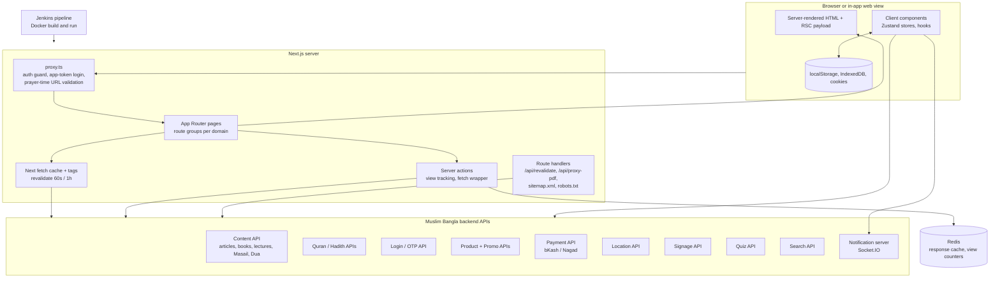

# Architecture

## Purpose

`muslimbangla-web-next` is the public web application of the Muslim Bangla platform. It is a single Next.js 16 (App Router, React 19, TypeScript) repository with no database of its own. It renders content fetched from separate Muslim Bangla REST services, adds interactive client features, and runs as a Docker container (or PM2 cluster) behind the production domain.

## Diagram



## Folder structure (trimmed)

```
muslim-bangla-web-next/
├── cicd/
│   ├── docker/Dockerfile          # Node 22 Alpine image, npm install, next build, npm start
│   ├── jenkins/Jenkinsfile        # Branch-aware build and deploy pipeline
│   └── scripts/                   # environment-setup, container-stop, image-build, image-remove
├── docker-compose.yml             # Builds and runs the image on port 3000
├── ecosystem.config.js            # PM2: next start, cluster mode, max instances
├── next.config.ts                 # image host allowlist, optimizeCss, external packages
├── changelog.md                   # Versioned changes (July to August 2025 entries)
├── git-branch-and-commit-naming.md
├── namaj_shikkha_*.db             # SQLite sources for the prayer-learning content
├── public/                        # icons, images, manifest, PDFs, namaj-shikkha JSON, Windows guide images
└── src/
    ├── proxy.ts                   # Request middleware (Next 16 "proxy")
    ├── app/
    │   ├── (home)/                # Landing page
    │   ├── (pages)/               # Main content domains (route groups):
    │   │   ├── (article)/         #   articles, blogs, writers, tags, bookmarks
    │   │   ├── (book)/            #   books, authors, categories
    │   │   ├── (dua)/ (hadith)/ (quran)/ (masail)/
    │   │   ├── (prayer-time)/     #   world, ramadan, salat-calender
    │   │   ├── (lectures)/ (speaker)/
    │   │   ├── (donation)/        #   donation, zakat calculator, zakat fund
    │   │   ├── (hajj-umrah)/      #   hajj guide, umrah, masail
    │   │   ├── (masjid-iqamah-time)/ signage/ (mosque)/
    │   │   ├── (salat)/           #   Namaz Shikkha (static JSON data), taharat
    │   │   ├── (today)/           #   Today's Amal (verse, hadith, dua, quiz)
    │   │   ├── (islamic-name)/ (others)/ (combined)/ (login)/ ...
    │   ├── (products)/            # Shop: catalogue, cart, checkout, invoice
    │   ├── (user)/                # Signed-in area: profile, bookmarks, Masail, donations, orders
    │   ├── @modal/(login)/        # Intercepted login modal (parallel route)
    │   ├── api/                   # Route handlers: revalidate, proxy-pdf
    │   ├── download/ payment/     # App download pages, retired bKash page
    │   ├── sitemap.xml/ robots.txt/
    │   └── layout.tsx             # Root layout: fonts, analytics, header/footer, providers
    ├── api/                       # ~50 API client modules (one per backend resource)
    ├── actions/                   # Server actions (view tracking)
    ├── components/                # Shared UI: layouts, homepage, comments, bookmarks, todays-amal, ui (shadcn)
    ├── stores/                    # Zustand stores
    ├── context/ contexts/         # React contexts (user, Quran/Hadith lookups)
    ├── hooks/                     # Custom hooks (audio, prayer UI, hajj checklist, quiz user...)
    ├── lib/                       # metadata, redis, IndexedDB caches, Today's Amal, helpers
    ├── providers/                 # PostHog, Socket.IO
    ├── services/                  # cookie/local-storage services, signage services, verifyUser
    ├── utils/                     # fetch wrappers, HTML renderer, date helpers, env
    ├── models/ types/ constants/ data/  # TypeScript models, constants, static data
    └── assets/                    # Local fonts, images
```

## Main routes and modules

About 165 page routes. Representative route groups:

| Module | Routes (examples) | Notes |
|---|---|---|
| Home | `/` | Hero, menu, Today section, app download, testimonials |
| Prayer time | `/world/{country}/{city}`, `/ramadan/...`, `/salat-calender/...`, `/world/prayer-times` | Client-side `adhan` calculation, URL validated in middleware |
| Quran | `/quran`, `/quran/sura/{id}`, `/quran/search`, `/sura/{id}/verse/{id}`, `/sura/{id}/tafsir/{id}`, `/topic-ayat/{id}` | Sura pages statically generated |
| Hadith | `/hadith-books`, `/hadith-book/{id}/chapter/...`, `/hadith/{id}`, `/rabis`, `/topic-book/...`, `/hadith-search-result` | Topic books statically generated |
| Dua / Sunnah | `/duas`, `/dua/{id}/{title}`, `/dua-categories`, `/others/sunnah...` | Server-side categories |
| Masail | `/masails`, `/masail/{id}/{subtitle}`, `/masail-category/{id}` | Ask flow under `/user/ask-masail` |
| Articles / blogs | `/articles`, `/article/{id}/...`, `/articles/tag/...`, `/blogs`, `/writers`, `/blog-writers` | Comments, share, related items |
| Books | `/book`, `/book/{id}/{name}`, `/authors`, `/book-category/...` | PDF reader |
| Lectures | `/lectures/latest`, `/lectures/trending`, `/lecture/{id}/{name}`, `/speakers`, `/speaker/{id}/{name}` | 60s revalidate on details |
| Today's Amal | `/today` | Daily content, quiz, leaderboard, audio |
| Hajj / Umrah | `/hajj-guide/*`, `/hajj-umrah/*` | Checklist saved in the browser |
| Donation / Zakat | `/donation`, `/zakat-calculator`, `/zakat-fund`, `/online-zakat`, `/recipients-of-zakat` | Payment API |
| Shop | `/products`, `/products/product/{slug}`, `/products/checkout`, `/products/invoice/{no}`, `/products/wishlist` | Cart in Zustand |
| Masjid tools | `/masjid-iqamah-time/*`, `/signage/*`, `/mosque` | Login-protected (iqamah) and role-aware |
| User | `/login`, `/user/profile`, `/user/bookmarks`, `/user/donations`, `/user/products`, `/user/revalidate` | Middleware-protected |
| Utility | `/combined` (search), `/support`, `/download`, `/app-permissions`, `/clear-storage/*`, `/expire-user`, `/monthly-report` | |
| System | `/sitemap.xml`, `/robots.txt`, `/api/revalidate`, `/api/proxy-pdf` | Route handlers |

## Rendering strategy

- **Default:** async server components that fetch data on the server (the changelog shows a deliberate move from client contexts and effects to server fetching).
- **Static generation:** `generateStaticParams` on Quran sura pages, topic-Hadith book and category pages, and Namaz Shikkha book pages.
- **Time-based revalidation:** `export const revalidate = 3600` on the root layout and on article, book, lecture and home layouts (and several pages); `60` on lecture detail pages. Two pages use `force-dynamic`.
- **Client components:** used for interactive areas (reader settings, prayer time UI, audio players, comments, bookmarks, voice search, PDF viewer loaded with `ssr: false`).
- **Parallel and intercepted routes:** the login dialog is an intercepted route in the `@modal` slot.

## Data fetching and external APIs

- **API client layer (`src/api`)**: about 50 modules, one per backend resource (articles/posts, books, Quran, sura, Hadith, topics, Dua, Masail, lectures, speakers, products, promo, payment, invoice, login, location, notification, quiz, signage-related and more). Base URLs come from `NEXT_PUBLIC_*` environment variables (names only; values are per environment and not documented here).
- **Fetch wrappers (`src/utils/fetchWrapper.ts` and `fetchWrapper.server.ts`)**: add auth headers (customer token), refresh-token handling on expiry, cache presets (5 s, 15 min, 1 h, 24 h) and Next.js cache tags. The server variant adds optional Redis caching for GET requests with a graceful fallback when Redis is unavailable.
- **Cache tags (`generateCacheTag.ts`)**: tags per content domain (Quran, Hadith, article, Masail, Dua, book and others), used by `/api/revalidate` and the staff `/user/revalidate` page.
- **Server actions**: view tracking (`actions/viewTracking.ts`) increments Redis counters; the fetch wrapper was converted to a server action per the changelog.
- **Static content**: Namaz Shikkha books are bundled JSON imported at build time; monthly report PDFs and some images live in `public/`.
- **Backend services consumed** (by role; hostnames are environment-specific): content API, Quran and Hadith APIs, login/OTP API, product and promo APIs, payment API, location API, notification server (Socket.IO), signage API, quiz API, search API, settings and customer-support URLs, and a CDN for media and audio.

## State management

- **Zustand** for global client state: user, bookmarks (persisted, with tags and backup/restore), cart (persisted), prayer times and prayer time adjustment, Quran translation and sura/para selection, Hadith audio, socket connection, article bookmarks. The changelog records moving the country/city list from React Context to Zustand.
- **React Context** for the current user and a few lookup lists (Quran topics, Hadith books, narrators, book categories, sura and para).
- **URL state** with `nuqs` and search params for filters, search and pagination.
- **Forms** with react-hook-form and Zod.
- **Browser storage**: cookies (user, token, app id), localStorage (Hajj checklist, location data), IndexedDB via `idb` (quiz exam data, notification images).
- TanStack Query provider exists in the repo but is commented out.

## Auth and access control

- Custom auth against the Muslim Bangla login API (OTP login, refresh tokens), with a `currentUser` cookie and an HttpOnly `token` cookie.
- `proxy.ts` redirects unauthenticated users on protected paths (`/dashboard`, `/profile`, `/user`, `/masjid-iqamah-time`) to `/login?next=...`.
- In-app sign-in: `token` and `app_id` query parameters are verified and converted into cookies (one-year lifetime, secure and domain-scoped in production).
- A `RoleGuard` component and `use-role-guard` hook gate role-specific UI. The `next-auth` package is in `package.json` but is not referenced in `src`.

## SEO and performance

- `lib/metadata.ts` (`createMetadata`) builds metadata with site name, taglines and canonical URL; most routes call it from `generateMetadata`.
- `sitemap.xml` route handler (static top-level paths only) and `robots.txt` route handler (disallows `/api/`, `/user/`, `/admin/` and others, and points to the sitemap).
- Local fonts with `display: swap`, `optimizeCss`, image host allowlist, `js.foresight` prefetching, Suspense skeletons, a top loader and `Viewport` theme colour.
- Google Analytics (via `next/script`) and PostHog for analytics.
- `manifest.json` in `public/`.

## Deployment

- **Docker:** `cicd/docker/Dockerfile` uses Node 22 Alpine, installs dependencies, runs `npm run build` (Turbopack) with a raised Node memory limit, and starts with `npm start` on port 3000. `docker-compose.yml` builds the image and runs it with an `.env` file.
- **Jenkins:** `cicd/jenkins/Jenkinsfile` is branch-aware: it makes scripts executable, writes the environment file from a Jenkins credential named after the branch, stops the existing container, removes the old image, builds a branch-tagged image, and runs it with `--restart=always` on a branch-specific port credential.
- **PM2:** `ecosystem.config.js` runs `next start` in cluster mode across all CPUs, as an alternative to Docker.
- **Environments:** `.env.development` and `.env.staging` exist in the repo (contents intentionally not reproduced); production values are injected by Jenkins.
- **Branching:** typed branches (`feat/`, `fix/`, `hotfix/`...) and gitmoji commit messages per `git-branch-and-commit-naming.md`.

## Third-party integrations

| Integration | Where used |
|---|---|
| `adhan` | Prayer time calculation |
| `hijri`, `moment-hijri`, `hijri-date`, `date-bengali-revised` | Hijri and Bangla calendar dates |
| bKash / Nagad (via payment API) | Donations, Zakat and shop checkout |
| Socket.IO client | Realtime notifications for signed-in web users |
| PostHog, Google Analytics | Product analytics |
| Redis (`ioredis`) | Response cache, view counters |
| react-pdf / pdfjs-dist | In-browser PDF reading (books, reports) |
| jsPDF, html-to-image, react-to-print | Invoice download and printing |
| `fflate` | Unzipping monthly notification image bundles |
| `idb` | IndexedDB wrapper |
| `js.foresight` | Intent-based prefetching |
| `country-state-city`, `react-phone-number-input` | Location and phone input |
| `react-h5-audio-player` | Audio playback |
| YouTube thumbnails and embeds | Lecture and home videos |
| Google search API (via client module) | Search integration |
| Windows app download | Download guide in `public/windows` |

## Notes and gaps worth knowing

- Several dependencies appear unused in `src` (`next-auth`, `react-bkash`, `react-google-recaptcha`, `react-player`), likely leftovers.
- A `route.ts` file exists under `src/api/google-search/`, outside `src/app`, so it is not a live Next.js route.
- The sitemap is static and does not enumerate dynamic content pages.
- The repo README's folder tree is a generated snapshot and may lag behind the current `src` layout.
