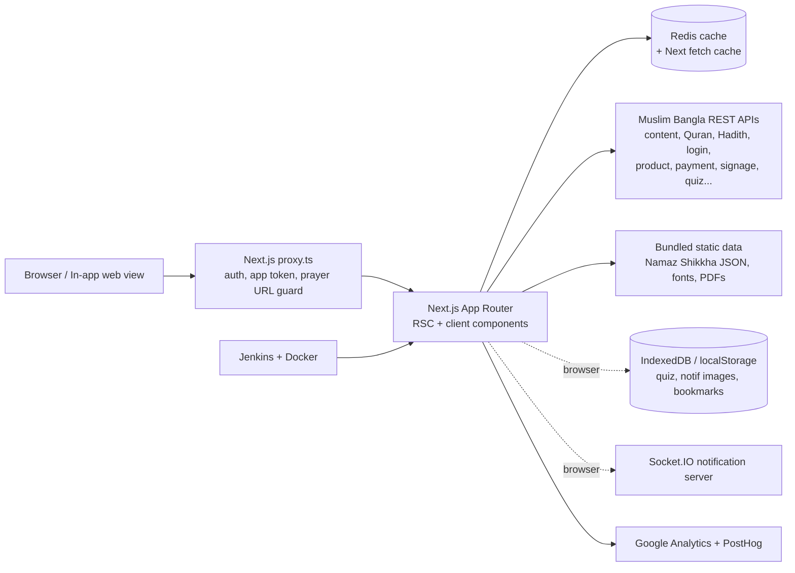

# Case Study: Muslim Bangla Website

## Overview

Muslim Bangla is a Bangla-language Islamic platform whose mobile apps and web presence serve Bengali-speaking Muslims in Bangladesh and abroad. This case study covers the public website, a single Next.js (App Router) application that exposes the platform's content and services in the browser: Quran, Hadith, prayer times, Dua, Masail (Islamic Q&A), articles, books, lectures, a daily "Today's Amal" page, Hajj and Umrah guidance, Zakat tools, an online shop, and masjid management tools.

The site does not own a database. It is a rendering, caching and interaction layer over a family of Muslim Bangla backend services, and it doubles as a web view inside the native Android and iOS apps.

## Background & Problem

The Muslim Bangla mobile apps are positioned (in the site's own metadata) as a comprehensive Islamic app for Bangla speakers, covering prayer times, Quran with translations and tafsir, Hadith, Dua, books, lectures, Masail and more. A native app alone leaves several gaps:

- **Discoverability.** Islamic content in Bangla is searched for on the open web. Content locked in an app cannot be found through search engines or shared by link.
- **Reach.** Users without the app, on desktop, or on low-end devices still need prayer times, Quran and Hadith.
- **Shared surfaces.** The apps themselves need web pages for things better built once: donation and Zakat flows, the shop and invoices, daily content, support pages and masjid tools.
- **Bangla typography.** Bangla and Arabic text, mixed in the same page, need careful font handling and sanitised HTML rendering to read correctly.

## Goals

Derived from the code and documentation (TODO: owner to confirm against the original brief):

- Publish the platform's content as crawlable, shareable, fast web pages with proper SEO.
- Provide accurate, location-based prayer times worldwide with local adjustments.
- Offer a high-quality Bangla reading experience for Quran, Hadith, Dua and long-form articles.
- Let users act as well as read: sign in, bookmark, comment, ask Masail, donate, pay Zakat, buy products.
- Work as an embeddable web layer for the mobile apps, including single sign-on from the app.
- Keep the site fast despite many remote API calls, through caching and prefetching.

## Solution

A Next.js 16 / React 19 application using the App Router, structured as route groups per content domain (`(article)`, `(book)`, `(dua)`, `(hadith)`, `(quran)`, `(prayer-time)`, `(lectures)`, `(masail)`, `(donation)`, `(hajj-umrah)`, `(products)`, `(user)` and others). Key ideas:

- **Server-first rendering.** Most content pages are server components that fetch from the backend APIs, with hourly (and some 60-second) revalidation; Quran sura pages are statically generated from the sura list.
- **Strong SEO scaffolding.** A shared metadata helper, per-page `generateMetadata`, a generated sitemap and robots rules, canonical URLs and human-readable URL slugs.
- **Hybrid interactivity.** Server-rendered shells with client components for the reader settings, prayer time calculation, audio players, comments and bookmarks.
- **A layered cache.** Next.js fetch cache with tags, plus an optional Redis cache for GET calls and Redis-backed view counters.
- **App-aware behaviour.** A middleware (`proxy.ts`) detects app tokens and app ids, sets cookies, hides site chrome in the app, guards protected routes and validates prayer time URLs.

## Users & Audience

- **Bengali-speaking Muslims** in Bangladesh and the diaspora (the site metadata names Bangladesh, India (Kolkata), the Gulf, Europe, Australia and Canada), reading Quran, Hadith, articles and Dua, and checking prayer times.
- **Signed-in app users** who bookmark, comment, ask Masail, take the daily quiz, donate and shop.
- **Mobile app users** who land on the site through an in-app web view.
- **Mosque administrators** who maintain iqamah times and manage mosque TV signage content.
- **Internal staff** who use the cache revalidation page and the support pages.

## System Architecture

The website is a stateless Next.js server (run as a Docker container or PM2 cluster) that renders pages by calling backend services, caches responses in Next.js and Redis, and hydrates client components for interactive features. See [architecture.md](./architecture.md) for the detailed breakdown.

## Key Technical Challenges & Decisions

### 1. Rendering strategy: server components with time-based revalidation

Content pages (articles, books, lectures, Masail, Dua, Hadith topics) are server-rendered with `revalidate = 3600` at the layout level, and shorter (`60`) on lecture pages. Sura pages use `generateStaticParams` over the full sura list so the Quran reader is pre-rendered. The changelog documents a deliberate migration from client-side contexts to server-side data fetching for the article and Masail pages (recent blogs, categories, writers, Dua categories), and a change of the prayer time page from a fully client component to a server component with a client calculation layer. Net effect: less client JavaScript and crawlable HTML.

### 2. SEO for Bangla content

A shared `createMetadata` helper centralises site name, taglines, canonical URL and Open Graph defaults, and nearly every route defines `generateMetadata`. `sitemap.xml` and `robots.txt` are route handlers. URLs include readable slugs (`/masail/{id}/{subtitle}`, `/dua/{id}/{title}`). SEO was rolled out section by section (articles, prayer time, Masail, Dua, speakers, lectures), as the changelog shows. A noted limitation: the sitemap lists only static top-level paths, not individual content pages.

### 3. Bangla and Arabic typography

Four local font files (Kalpurush for Bangla, Tajawal and Uthmanic for Arabic, Noorehuda) are loaded via `next/font/local` and exposed as CSS variables, with `display: swap` and preload. Shared `ArabicBanglaText` components pick the right font per script. API-provided HTML is rendered through an `HtmlRenderer` that sanitises with DOMPurify; the changelog records a fix for Arabic font issues in injected HTML and a later replacement of raw `dangerouslySetInnerHTML` with that renderer. Dates use Bangla locale formatting, a Bangla calendar library and Hijri libraries.

### 4. Prayer times: accuracy, URLs and user adjustment

Prayer times are calculated client-side with the `adhan` library from the selected city's coordinates, with the logic extracted into util files and hooks (changelog 0.1.2). URLs follow `/world/{countryCode}/{city}`; the middleware validates the country and city against the location API and falls back to Dhaka for unknown locations. Users can adjust times and the Hijri date; adjustments live in a persisted Zustand store. Country and city lists are fetched only when the locally saved copy does not match (changelog 0.1.1). The page also handles edge cases such as an Asr warning dialog, a sunset warning, forbidden (makruh) times and Nafl prayer times, and extends to Ramadan timetables and month calendars.

### 5. Layered caching and fetch design

Two fetch wrappers (client and server-only) add token handling, refresh-token logic and cache time presets (no-cache 5s, short 15m, medium 1h, long 24h). The server wrapper can also read and write a Redis cache for GET requests, and falls back gracefully when Redis is not connected. Cache tags are generated from URL patterns (quran, hadith, article, masail, dua, book and others) so staff can revalidate by section from a protected `/user/revalidate` page backed by `/api/revalidate`. View counts for articles and authors use Redis counters via server actions.

### 6. Running both as a website and inside the mobile apps

The middleware accepts `token` and `app_id` query parameters, verifies the user against the API, and stores cookies (`token` as HttpOnly) so the web view is signed in. The root layout reads the app id cookie and conditionally renders the header, footer, download modal, support button and notice banner; the Socket.IO connection is also skipped inside the app. This lets web pages (donation, Zakat, shop, daily content) be reused by the apps without a second UI.

### 7. Static bundled content instead of a runtime database

The repo root contains two SQLite files for the Namaz Shikkha (prayer learning) feature. They are not queried at runtime: a comment in the data module says the content was converted to JSON and is imported statically so server components get it "without a runtime fs/fetch". The site therefore ships the two books with the build, and pages such as `/others/learn-salat` render from that data with a book `generateStaticParams`. (How the conversion script was run is not in the repo: TODO: owner to confirm.)

### 8. Client-side persistence for offline-friendly features

Several features keep data in the browser: the daily quiz exam data and daily notification images are cached in IndexedDB (via `idb`), the notification images arrive as one monthly zip from the CDN and are unpacked in the browser with `fflate`; Hajj checklist progress is stored in localStorage; bookmarks use a persisted Zustand store with backup and restore; prayer time settings are persisted. These reduce repeat API calls and make repeated visits faster.

### 9. Performance and perceived speed

`js.foresight` predicts user intent from cursor movement to prefetch routes (introduced in changelog 0.2.4, first on article pagination). Other measures: CSS optimisation (`experimental.optimizeCss`), Next.js image optimisation with a restricted remote host allowlist, a top loader, Suspense skeletons (for example for comments), list virtualisation libraries in dependencies, dynamic imports with `ssr: false` for the PDF viewer, and canvas and pdfjs marked as server external packages.

### 10. Payments and commerce

Donations, Zakat and shop orders go through a separate payment API. bKash now uses a hosted checkout (the API returns a URL and the browser is redirected), and an older iframe-based bKash page was retired but kept as a redirect to the invoice page so old links and open tabs do not 404. Invoices can be downloaded as PDF or image from the browser.

### 11. Team workflow and delivery

The repo documents branch and commit naming conventions (typed branches, gitmoji commit messages), keeps a changelog, and deploys through a Jenkins pipeline that builds a branch-tagged Docker image and runs it on a branch-specific port, with environment files injected from Jenkins credentials.

## Outcome & Impact

- **Delivered:** a broad web platform covering many content and service areas with about 165 page routes in the App Router, deployed through a containerised CI/CD pipeline. (Counts are from a code inventory, not from analytics.)
- **Impact metrics:** TODO: add traffic, sessions, search visibility, app-install referrals, donation or order volumes, if available and shareable.
- **Performance results:** TODO: add Lighthouse / Core Web Vitals before and after, if measured.
- **User feedback:** TODO: add if available. (The home page includes a testimonials section; its content has not been verified as real data.)

## What I Learned

TODO: owner to confirm and personalise. Themes the code supports:

- Choosing between server and client rendering per page, and moving data fetching to the server to cut client JavaScript and improve SEO.
- Designing a cache hierarchy (fetch cache, tags, Redis) with a manual revalidation path for editors.
- Handling Bangla and Arabic typography and sanitising HTML from multiple content sources.
- Building one web codebase that serves browsers and native-app web views.
- Prayer time and Hijri calendar edge cases (location validation, adjustments, Asr and sunset warnings).
- Keeping a large multi-contributor Next.js codebase organised with route groups, domain folders and shared UI primitives.

## My Role & Contributions

> Placeholder for the owner. Tick what applies and add detail. First person here.

- [ ] I was the (TODO: lead / sole / one of N) frontend developer on this project
- [ ] I built or contributed to these sections: TODO (see [key-features.md](./key-features.md) for the pruned list)
- [ ] I set up or changed the architecture (route groups, data fetching, caching): TODO
- [ ] I implemented SEO (metadata, sitemap, robots, canonical URLs): TODO
- [ ] I worked on prayer times / Hijri calendar logic: TODO
- [ ] I worked on the Quran / Hadith readers: TODO
- [ ] I worked on auth, in-app login handoff and protected routes: TODO
- [ ] I worked on payments / checkout / invoices: TODO
- [ ] I worked on CI/CD, Docker or PM2 deployment: TODO
- [ ] I reviewed code / mentored others / wrote documentation: TODO
- Team size and collaborators: TODO
- Duration and dates: TODO
- Measurable results I can claim: TODO
